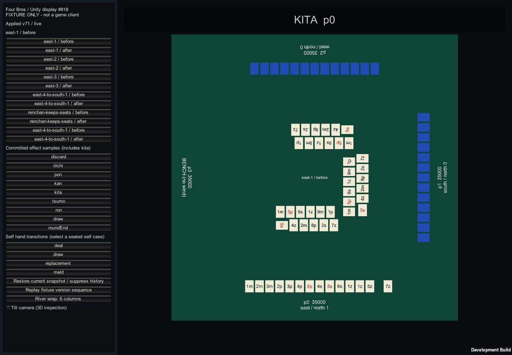

# #818 Unity表示プロトタイプ実装記録

## 現在の結論: 2026-09-08 実Unity検証

**自作プリミティブによるUnity表示試作はGo。製品クライアントへの採用はNo-Go。**
`2074f2c`を基準にした専用worktreeで、Unity **2022.3.62f2**（`7670c08855a9`）の
実APIコンパイル、`JsonUtility`解析、最小シーン生成、macOS Developmentビルド、
Metalによる描画を実行した。過去の「Unity未導入／未実行」は下記の履歴時点の記録であり、
現在の環境・結果を表さない。

対象はmacOS Standaloneの表示スパイクとする。同じ作業端末で検証でき、既存の表示契約と
サーバー／Domainの状態所有権を変えずに成立することが確認できたためである。
OSSのUnity 2019.1.8f1、既存Prefab、第三者素材を取り込む必要はなかった。
WebGL／モバイル／本番通信／製品配布の採用判断は今回の結果から導かない。

### 実行で発見・修正した問題

1. **復元操作で`Invalid drawn tile`が発生した。** Unityのinline JSON serializationは、
   `drawn=null`や`effect=null`を空のオブジェクトにし、`handTransition=null`を空文字にする。
   .NETの`System.Text.Json`を使った旧チェックでは再現しなかった。
   メモリ内復元専用の`DisplaySnapshotJson`にpresence flagsを持たせ、JSON往復後に
   「存在しない」状態を戻す。入力前と復元後の`DisplayValidation`は維持する。
   これは新しい通信プロトコルでも、不正な受信JSONを正規化して通す仕組みでもない。
2. **牌文字が牌の数倍になり、河・手牌・座席ラベルが重なった。**
   `TextMesh.characterSize`の実寸は`fontSize`にも依存するため、指定した盤面寸法になるよう補正した。
   実`Renderer.bounds`が牌の範囲内に収まる検査を追加した。
3. **左パネル背景がマゼンタになった。** カメラは盤面viewportのみをクリアするため、
   その外側のGUI領域を明示的に描画するよう修正した。

実行ハーネスは通常のIMGUIボタンと同じ操作ハンドラを呼び出し、実フレームをPNG化する。
初期化失敗、検査失敗、レポート書込み失敗時は成功扱いせず終了する。
出力先は空ディレクトリに限定し、前回の成果物の混入を防ぐ。

### 実行証跡と測定境界

検証端末は **Apple M2（8 CPU cores / 10 GPU cores）、メモリ8GB、macOS 26.2、Metal**。
本番想定端末全体の代表性を主張するものではない。

- Unity Editor内で実`JsonUtility`を通した表示コア: **2,267 assertions成功**。
- macOS Player: **1440×1000と960×640**で全12状態×4/6列、全状態JSON復元、
  9演出、4手牌遷移、version sequence、傾斜カメラを検証。**各6,954 assertions成功、errors 0**。
- 各実行は **44枚の実フレームPNG** と性能JSONを生成し、Unityログのerror/exception/assertを検出したら失敗する。
- 実GameObjectの座席、持ち点、手牌／裏牌枚数、河の座標／向き、文字の実寸、
  遷移前後の移動、復元時の演出抑止を確認する。
- フレーム時間はPNG保存処理後の180フレーム。操作処理時間とCPUフレーム末尾までの時間は30回。
  メモリは`Profiler`のallocated／reserved／managed値であり、OSプロセスRSSではない。
- **物理クリックから表示までの遅延は未測定**。測定値は操作ハンドラ呼出しから
  CPU側のend-of-frameまでで、入力機器・OS入力配送・GPU完了・画面走査を含まない。
  System Eventsによる実クリック操作はApple Events権限拒否（`-1743`）で実行できなかった。
  権限設定を変更して回避していない。

| 測定 | 1440×1000 | 960×640 |
|---|---:|---:|
| frame time 中央値／p95 | 16.675／17.552 ms | 16.662／17.477 ms |
| 状態切替ハンドラ 中央値／p95 | 3.615／4.183 ms | 3.635／4.846 ms |
| ハンドラ→CPU end-of-frame 中央値／p95 | 4.454／5.732 ms | 4.837／6.741 ms |
| Unity allocated／reserved | 45,138,216／216,629,248 bytes | 45,311,792／183,074,816 bytes |
| managed memory | 712,704 bytes | 671,744 bytes |

どちらもvSync=1、targetFrameRate=-1のDevelopmentビルドで、短時間・共有作業端末での値。
ビルドレポートのサイズは **214,623,897 bytes**。シーン生成・Playerビルド成功、
C#コンパイラのwarning/errorは0。非空の証跡ディレクトリを与える負例では、
`Use an empty evidence directory`を記録しPlayerが**exit 1**で終了することも確認した。

代表画像と機械可読レポートは [実Unity証跡ディレクトリ](../evidence/unity-display-20260908/) に収録する。
全PNGの再生成は[READMEのコマンド](../../prototypes/unity-display/README.md)で可能。
レポートのスクリーンショット一覧は1回の全44枚を示し、リポジトリには代表画像を抜粋している。




### 視認性と採用判断

1440×1000の俯瞰では牌の文字、リーチ横置き、ツモ間隔、座席方向を確認できる。
960×640でも盤面の欠け・席間重複はないが、牌記号と座席文字が小さく、製品UIには
ズーム／文字倍率／操作パネルの再設計が必要。傾斜時は裏牌の側面が重なり青い帯に見える
箇所があり、製品素材・陰影・輪郭を使った読みやすさの検証が必要である。
9演出は文字バナー、手牌遷移は固定見本であり、完成した対局体験とは扱わない。

「表示契約を保ったままUnityで河・手牌・席回転・主要演出を再現できるか」は実行証拠付きで
肯定できる。既存Webの代替となる製品採用については、専用UI、実ゲーム入力、通信、
対象端末、素材許諾の検証が揃っていないためNo-Goとする。

| #818受け入れ条件 | 現在の結果 |
|---|---|
| 対象／Unity版／実行環境／理由 | macOS Standalone、2022.3.62f2、M2／Metalで実行。選定理由を記録 |
| 河／リーチ横置き／ツモ間隔／主要演出 | 実PlayerのPNG、GameObject検査、手牌遷移の移動検査で確認 |
| 3着席＋1抜け番、全回転、局替わり、リロード | 12状態×2列設定、実JSON復元を2解像度で実行。version sequenceも成功 |
| ルールSSOT／状態所有権 | 表示DTOと固定fixtureのみ。ルール、点数、局進行、通信の複製なし |
| 素材／ライセンス境界 | 新規C#とUnity同梱primitive／font／shaderのみ。OSSコード・第三者素材のコピーなし。任意FBXは#1165で別管理 |
| PNG／手順／制約／工数 | 実PNG・測定JSON・再現手順あり。物理入力／画面走査の遅延は未検証として明記 |
| Go／No-Goと後続分割 | 表示試作Go、製品採用No-Go。下記に実装範囲と必要条件を記録 |

### 概算の残コストと後続分割

これは計画レンジであり、今回の作業時間や実測の追随コストではない。
旧見積りの「Editor導入0.5–1人日」「最小シーン初回起動」は本端末では完了した。

| 後続範囲 | 計画レンジ | 必要な証拠 |
|---|---|---|
| 製品UI・牌／席文字倍率・傾斜時の読みやすさ | 1–3人日 | 対象解像度、入力操作、可読性評価 |
| 北抜き等の専用演出・アクセシビリティ | 0.5–1.5人日 | 表示のみの実装、実ゲーム通知との境界 |
| 物理入力から表示までの遅延と端末別負荷 | 1–2人日 | 操作許可済み端末、入力計測方法、Releaseビルド、長時間実行 |
| 表示契約1変更あたりの追随 | 0.5–1人日／回 | fixture、C#チェック、2解像度でのPlayer検証 |
| 本番snapshot adapter／認証／resume | 別途見積り | サーバー側の契約、ルールSSOTと秘匿境界を維持した統合テスト |
| 素材権利と配布形態の判断 | 権利確認の待ち時間を除外して別途見積り | 採用素材ごとの許諾、Standalone／WebGL等の対象確定 |

実表示スパイクの成果と製品採用の残条件を分け、物理入力・製品UI・通信の未検証を
「Unityが未導入だから」という古いブロッカーに戻さない。Blender側は#1165を参照。

## 履歴: 2026-09-07 初回実装と、実Unity起動前の記録

以下は当時の結果を保存した履歴である。現在の判定・実行環境・残条件は上記を正とする。

2026-09-07 JST。基準commit `43bb819`。既存の表示契約・Webリファレンスと過去の
テキストスパイクを再利用し、`prototypes/unity-display` に表示専用C#プロジェクトを追加した。
手順・ファイル構成・FBX接続口は [プロジェクトREADME](../../prototypes/unity-display/README.md) を参照。

## 判定

**最小プロトタイプのコードレビュー・実Unity検証へ進める。製品採用はNo-Goを維持する。**
ユーザーは#818/#1165の実装を依頼し、Unity Hub/Editorが未インストールであることを確認した。
Unityを起動・インストール・認証・ビルドしたとは扱わない。今回追加したのは、
実行可能な表示コア、Unity向け描画コード、再生成可能な1シーンのEditor入口と検証手順である。
生成済み`.unity`やUnityスクリーンショットはまだない。

| 項目 | 選定・結果 |
|---|---|
| 最初の対象 | macOS Unity Editor / macOS Standalone。現作業端末と同じOSで表示を先に検証するため |
| 固定候補版 | Unity **2022.3.62f2**, revision `7670c08855a9`。既存2022.3候補を再現可能に固定。[公式リリース](https://unity.com/releases/editor/whats-new/2022.3.62f2)に存在とrevisionを確認。実行確認済み版・最新推奨版・製品採用ではない |
| OSS側の2019.1.8f1 | 採用せず。古いPrefab/アセット依存を導入しない新規表示コードとする |
| 外部パッケージ | なし。Unity同梱IMGUI/JSON/Physics/TextRenderingモジュールだけを明示 |
| 牌・卓 | 自作コードによる単色キューブと英数字TextMesh。既存キャラクター原本・OSS Assetsの流用なし |
| 実行済み環境 | macOS ARM64、隔離した一時ディレクトリの.NET SDK **8.0.424**。表示コアのみ |
| 未実行環境 | Unity Editor/Runtime、Unity C# APIコンパイル、JsonUtility、実機描画、Standalone/WebGL/iOS/Android |

## 実装した範囲

既存fixtureから4回転×前後＋連荘/東4→南1×前後の**12状態**を読み込む。
player IDの物理位置はfixtureの`slotShape`に固定し、席風・抜け番・点数は各入力値から表示する。
Unity側に親流れ・連荘・点数・ルールの導出コードは置いていない。

河は6列/4列を切り替え、横向きリーチ牌の幅を考慮して同じ河内と隣席の河との間隔を取る。
手牌は自家のみ牌面を受け取り、他家は枚数だけから裏面を表示する。
ツモ/置換200ms、決定的な配牌遅延、鳴き後整列、打牌末尾追加の短い位置補間を用意した。
9種の演出（既存8種＋北抜き）は、コミット済み表示snapshotのeffect IDから表示する。
演出は文字バナーであり、フルアニメーション・音声・スクリーンリーダー通知の完成品ではない。

表示ゲートは同一roomの同値/古いversionを拒否し、不正な入力ではwatermarkを進めない。
初回・room切替・復元時は過去のeffect/牌入場を再演出しない。
effect IDはroom内で一意とし、局替わりでも消費済みIDを保持する。新しいIDの演出は局替わり時も表示する。
UIには固定version sequence再生と、現在のsnapshotをJSON往復で復元する操作を置いた。
これはメモリ内の表示復元であり、オンライン認証・resume・保存永続化の実装ではない。

`IDisplayAssetProvider` / `OptionalModelAssets`をFBX注入口とし、未割当ならプリミティブを使う。
#1165のBlender出力と専用Editorプレビューは別レーンの成果物で、#818単独の依存にしない。
寸法・原点・軸の整合やFBX取り込み成功はUnity上で別途確認が必要。

## 実施済み検証

リポジトリルートで実行したコマンド（`dotnet`は一時SDKの実行ファイル）:

```bash
check_dir="$(mktemp -d /tmp/unity-display-checks.XXXXXX)"
export DOTNET_CLI_HOME="$check_dir/home"
export DOTNET_GENERATE_ASPNET_CERTIFICATE=false DOTNET_CLI_TELEMETRY_OPTOUT=1
dotnet build prototypes/unity-display/Tests/DisplayContractChecks.csproj \
  -p:BaseIntermediateOutputPath="$check_dir/obj/" -p:BaseOutputPath="$check_dir/bin/"
dotnet "$check_dir/bin/Debug/net8.0/DisplayContractChecks.dll" documents/fixtures/unity-display-contract.json
git diff --check
```

結果: **2267 assertions passed**（ビルド警告/エラーともに0）。実際の`DisplayContract.cs`と`FixtureScenarios.cs`を
.NET 8でコンパイル・実行した。独立したJSによるC#ロジックの模倣テストではない。

- 12状態の座席投影、4人全員の抜け番、点数のplayer ID紐付け、他家の牌面非公開
- fixture指定の演出・手牌遷移の網羅、200ms、北抜き・鳴き後の表示例
- 4/6列の河座標、捨て順、リーチ横向きと席間を含む非重複、ツモ牌の追加間隔、4方向角度。描画側も直接使う`RiverOnBoard`で全12状態の通常時/打牌追加後の牌境界を比較。各席の非対称な牌の期待座標も固定し、左右の鏡像配置を検出
- `41 apply → 42 apply → 41 ignore → 42 ignore → 43 apply`
- 同一effect IDの局替わりをまたぐ重複抑止、局替わり時の新しいIDの表示、リロードの静的復元、room切替によるID履歴リセット、明示restore
- schema違い、抜け番の風/北、他家牌面、重複player/position、null牌の拒否、拒否後の正常復帰

`git diff --check`は成功。C#チェックは同じコードをEditorメニューからも実行できるが、
今回の.NET実行ではパーサーに`System.Text.Json`を使っている。
追加した回帰検査は修正前の配置で`self[11] / right[0]`の間隔`-0.03`を検出し、
配置修正後には局替わりでの同一effect ID再演出を検出した。両修正後に全検査が通過した。
席の回転計算でsinの符号を反転する負の検証も行い、期待座標の検査が`left river board x`で拒否した。元の計算へ戻した後に再度全検査を通した。
**Unity APIのコンパイル、JsonUtilityの解析、GameObject配置・回転、文字・演出の描画は未確認**。
Unityの代用品としてAPIスタブを作ってコンパイル成功とすることも行っていない。
Web実装を変更していないため、既存WebテストをUnity成果として再掲しない。

## 2026-09-08 追記: Unity・.NETなしでの追加検証（基準commit `a1995bb`）

この日の作業環境には **Unity Hub / Unity Editor に加えて .NET SDK も無い**。

```
$ which dotnet mono csc mcs unity Unity
dotnet not found / mono not found / csc not found / mcs not found / unity not found / Unity not found
$ ls /Applications | grep -i unity   # 出力なし
$ ls -d ~/.dotnet /usr/local/share/dotnet /Library/Frameworks/Mono.framework
（いずれも存在しない）
```

したがって 2026-09-07 に記録した **2267 assertions の.NET実行は、この回では再実行していない**。
過去の実行結果を今回の証跡として再掲もしない。新規に何かをインストールもしていない。

### 見つけた穴: C#表示コアはどのCIでも実行されない

`.github/workflows/ci.yml` に `dotnet` のセットアップ・実行stepは無く、
`prototypes/unity-display/**` を参照するjobも無い。
つまり `DisplayContract.cs` の `EffectKinds` / `TransitionKinds` と、
`documents/fixtures/unity-display-contract.json`、Web実装(`gameEffect.ts` /
`HandTileAnimation.tsx`)は **無検査で乖離しうる**状態だった。

そこを埋める `src/test/unity-display-csharp-contract.test.ts` を追加した。
C#を実行せず、C#ソースが宣言している集合をテキストとして読み取り、契約fixtureとWeb実装に突き合わせる。
Unity Editorも.NET SDKも不要で、`pnpm test`（=CIのqualityゲート）に載る。
C#のコンパイル・実行・Unity API・描画を検証するものではない。

### 見つけた欠落: 北抜き(ガリ)演出

追加したガードは、書いた直後に **3件失敗した**（`unityOnlyKindsが無い`）。原因は実際の欠落である。

- #818の受け入れ条件は「リーチ/鳴き/**北抜き**/和了/流局」の演出再現を求めている。
- C#の `DisplayValidation.EffectKinds` は9種（`kita` を含む）。
- しかし契約fixtureの `major-effects.kinds` は8種で、**`kita` を一度も要求していなかった**。
- Web側 `GameEffectKind` も8種で、**北抜きの瞬間の演出はWebに実装が無い**
  （抜いた枚数の常時表示 `KitaDisplay` はある）。

そのため契約に `unityOnlyKinds: ["kita"]` と理由を追加し、
「Web演出8種 ∪ Unity専用1種 = C#の9種」を上記ガードで固定した。
Unity側には `UnityDisplayPrototype` の `kita` ボタンと共通の文字演出、
`FixtureScenarios` の北枚数更新が実装済み。Editor上の表示検証と専用表現の検討が残り、
Webリファレンスには比較対象の見本が無い。
この非対称は工数見積りとGo/No-Goの前提であり、隠さず契約と画面に出す。

### ブラウザ・リファレンスによる席ローテーション/局替わりの画面証跡

`/prototype/unity-display` に、契約fixtureの**全12状態**
（席回転4件×前後 + 局替わり2件×前後）を、本番の `PlayerSlot` / `PlayerArea` /
`BenchArea` / `Discards` / `KitaDisplay` でそのまま描く一覧を追加した。
物理スロット（自家=下 / 上家=左 / 対面=上 / 下家=右）は契約の `slotShape` に固定し、
席風・親・抜け番・持ち点が入力どおり入れ替わる。ガリ枚数はfixtureの入力ではなく、
表示用サンプルとして各状態の東家に1枚を設定する。
親流れ・点数計算はここに無く、fixtureの値をそのまま読む。

これは **Unity Runtimeではない**。Unity画面の代用として扱わないが、
「席が回っても4物理スロットが崩れない」「局替わりで持ち点がプレイヤーに残る」
という受け入れ条件を、Unityなしで**実ブラウザのレイアウトとして**確認できる。

### 再現コマンド（このリポジトリだけで完結する分）

```bash
pnpm install
# 表示契約fixtureの検証
pnpm exec vitest run --project unit src/test/unity-display-contract.test.ts
# C#表示コア × 契約 × Web実装の整合ガード（.NET不要）
pnpm exec vitest run --project unit src/test/unity-display-csharp-contract.test.ts
# ブラウザ・リファレンスのコンポーネント検証
pnpm exec vitest run --project component src/components/prototype/UnityDisplayReference.test.tsx
# 実ブラウザでの12状態＋演出＋スクリーンショット出力
pnpm exec playwright test e2e/unity-display-reference.spec.ts --project=chromium
```

Playwrightは `test-results/<spec>-<test>-chromium/` に次のPNGを出力する
（`.gitignore` 済みのため、リポジトリへは同梱しない）。

- `unity-818-rotation-boards.png`: 12状態の一覧（4回転＋連荘＋東4→南1）
- `unity-818-rotation-east-1-before.png` / `-after.png`: 席回転の前後
- `unity-818-progression-east-4-to-south-1-before.png` / `-after.png`: 局替わり(東4→南1)の前後
- `unity-818-reference-page.png`: ページ全体

.NET SDKがある環境でのC#実行（この回は未実行）:

```bash
check_dir="$(mktemp -d /tmp/unity-display-checks.XXXXXX)"
export DOTNET_CLI_HOME="$check_dir/home"
dotnet build prototypes/unity-display/Tests/DisplayContractChecks.csproj \
  -p:BaseIntermediateOutputPath="$check_dir/obj/" -p:BaseOutputPath="$check_dir/bin/"
dotnet "$check_dir/bin/Debug/net8.0/DisplayContractChecks.dll" documents/fixtures/unity-display-contract.json
```

Unity Editorがある環境での検証（この回も未実行）:

```bash
UNITY_EDITOR=/Applications/Unity/Hub/Editor/2022.3.62f2/Unity.app/Contents/MacOS/Unity
"$UNITY_EDITOR" -batchmode -quit -projectPath "$PWD/prototypes/unity-display" \
  -executeMethod FourBros.Display.Editor.DisplaySceneBuilder.Validate -logFile /tmp/unity-818-validate.log
```

## Unityなしで確認できること / Editorが必須なこと

| 観点 | Unityなしで確認済み | Unity Editorが必須（未確認） |
|---|---|---|
| 河の配置・折り返し・リーチ横置き | Web `Discards` の実装と実ブラウザ描画。C#側は純粋座標計算として設計済み | Unityの実GameObject配置・回転・カメラ越しの見え方 |
| 手牌のツモ間隔・遷移 | 契約の200msがWeb `HAND_ANIMATION_DURATION_MS` と一致することをテストで固定 | Unityでの補間・入場の実描画とフレーム挙動 |
| 演出9種 | Web実装8種の発火をE2Eで確認。北抜きはWeb未実装として契約に明示 | UnityでのIMGUI/文字演出（北抜きも実装済み）の実描画検証、専用表現の検討 |
| 4物理スロット・全席回転・局替わり | 12状態を実ブラウザで描画し、4/3/1の内訳・席風・抜け番・持ち点保持を自動検証 | Unityでの席再配置と過去演出の抑止を録画で確認 |
| 表示契約・状態所有権 | fixture・C#ソース宣言・Web実装の三者整合を`pnpm test`で固定 | 変更なし（Unity側にルール計算を置かない設計は維持） |
| JsonUtility / UnityEngineコンパイル | 不可 | 必須 |
| 実機性能・入力遅延・ビルドサイズ・録画 | 不可 | 必須 |

## 受け入れ条件の現状

| #818の条件 | 現状 | 完了に必要な確認 |
|---|---|---|
| 対象プラットフォーム/Unity版/実行環境/採用理由 | **文書のみ確定**。macOS Editor/Standalone、候補版2022.3.62f2(rev `7670c08855a9`)、OSSの2019.1.8f1不採用、外部UPMなしを理由付きで記録 | 実際に起動した版・OS/CPU/GPU・解像度の実測記録 |
| 最小シーンで河・手牌・主要演出 | **部分**。C#の描画コード・シーン生成入口・純粋座標計算あり。Web側で河/折り返し/リーチ横置き/ツモ間隔を実ブラウザ確認 | Unityで起動し操作表の全項目とスクリーンショット/録画 |
| 全ローテーション＋局替わりで崩れない | **Unityなしの範囲で達成**。12状態を実ブラウザで描画し自動検証・PNG出力 | Unityの実GameObject再配置を同じ12状態で確認 |
| ルールSSOTと状態所有権の維持 | **達成**。Unity側にルール・点数・席回転計算・通信は無い。契約とC#宣言とWeb実装の整合を`pnpm test`で固定 | 本番adapter追加時にも同じ境界を維持 |
| OSS/現行素材/自作素材の境界とライセンス | **今回の成果物については達成**（下記） | 任意FBX・本番素材を入れる場合は個別の権利確認 |
| スクリーンショット/録画・手順・制約・工数 | **部分**。Web側PNGと再現コマンドを整備、既知の制約を明記 | Unity画面のPNG/録画、Profiler、入力遅延、ビルドサイズ |
| Go/No-Go と後続Issue分割 | **暫定判断のみ**（下記） | Unity実行証跡と権利確認の後に確定 |

## ライセンス境界の結論（今回追加分）

- 追加したC#・レイアウト計算・文字列・シーン生成手順は、このIssue向けの**新規実装**である。
- 指定OSS(`ArcturusZhang/Mahjong`, MIT)の **C#/Prefab/Animation/シーンは1行も取り込んでいない**。
  参照したのは公開されたテキスト上の設計方針だけで、コピー・改変・再配布はしていない。
- そのOSSのREADMEはゲーム内リソースをMajsoulから取得すると記載しているため、
  MIT表記のコードと画像・音声・フォント等の第三者素材は**分離して扱う**。素材は取り込まない。
- プリミティブ、Unlit/Color、組込みフォント、IMGUI/JSON/Physics/TextRenderingモジュールは
  Unity同梱機能であり、Unity Editorのライセンス下で利用する（外部UPM/Asset Storeは不使用）。
- ブラウザ・リファレンスが使うキャラクター画像・牌素材は、既に本リポジトリで管理している
  自作/権利確認済み資産（`documents/assets/` と `public/`）であり、今回新たな素材は追加していない。
- 任意FBX(#1165)と本番素材の利用・改変・再配布可否は、**この作業では判定していない**。別途レビューが必要。

## 概算コスト（実測ではなく計画レンジ）

既存の全スパイク計画レンジ 8.5–17人日は据え置く。今回時点での追加内訳は次のとおり。

| 項目 | 目安 | 前提 |
|---|---|---|
| Unity Hub/Editor導入・ライセンス有効化・初回コンパイル | 0.5–1人日 | アカウントと承認があること |
| Unity上の描画調整・シーン生成・12状態の画面証跡 | 1–3人日 | 既存C#がそのままコンパイルできる場合 |
| 北抜き演出の表示検証・専用表現の検討（Web側に見本が無い） | 0.5–1人日 | 共通の文字演出は実装済み。表示のみでルール側の変更を含まない |
| 性能・入力遅延・メモリ・ビルドサイズ測定 | 1–2人日 | 対象端末が決まっていること |
| 表示契約の変更1回あたりの追随（fixture更新+Unity再検証） | 0.5–1人日/回 | 保守コストの継続分 |

いずれも実測工数でも確約でもない。不具合規模・端末数・権利確認の待ち時間は含まない。

## 暫定Go/No-Go

**本番移行は条件付きNo-Go、Unity Editorが用意でき次第の最小シーン検証はGo**（従来判断を維持）。

Go/No-Goを確定させる条件:

1. Unity Hub/Editor 2022.3系が導入され、`prototypes/unity-display` が**警告0でコンパイル**する。
2. `JsonUtility` が `documents/fixtures/unity-display-contract.json` を解析でき、
   `Four Bros > Validate display contract` がEditor内で通る。
3. 12状態と操作表の全項目のスクリーンショット/短い録画がConsole例外0で取れる。
4. 対象端末で frame time / 入力遅延 / メモリ / ビルドサイズが記録される。
5. 素材を入れる場合、利用・改変・再配布の許諾が独立に確認される。

上記1–3が満たされない、または表示契約の追随コストが 0.5–1人日/回 を大きく超える場合は、
現行Web実装の継続（Unity不採用）を推す。

## 後続Issue分割案

| 後続Issue案 | 範囲 | 依存 |
|---|---|---|
| `unity/editor-bringup` | Unity Hub/Editor導入、コンパイル、`JsonUtility`検証、生成シーンの起動 | 環境・ライセンス |
| `unity/display-evidence` | 12状態＋操作表のスクリーンショット/録画、Console例外0の確認 | `unity/editor-bringup` |
| `unity/kita-effect` | 既存の北抜き文字演出の実描画検証と専用表現の検討（Web側に見本が無い分） | `unity/editor-bringup` |
| `unity/performance` | frame time・入力遅延・メモリ・ビルドサイズの実測 | 対象端末の確定 |
| `unity/assets-rights` | 任意FBX・本番素材の利用/改変/再配布の権利確認 | 素材候補の確定 |
| `unity/transport` | 表示snapshotの配信・認証・resume（#818の対象外） | サーバー側の確定 |
| `unity/release-gate` | 採用判断と配布形態（Standalone/WebGL）の決定 | 上記すべて |

この時点では#818を閉じていなかった。現在の実Unity結果と残条件は冒頭を参照。
