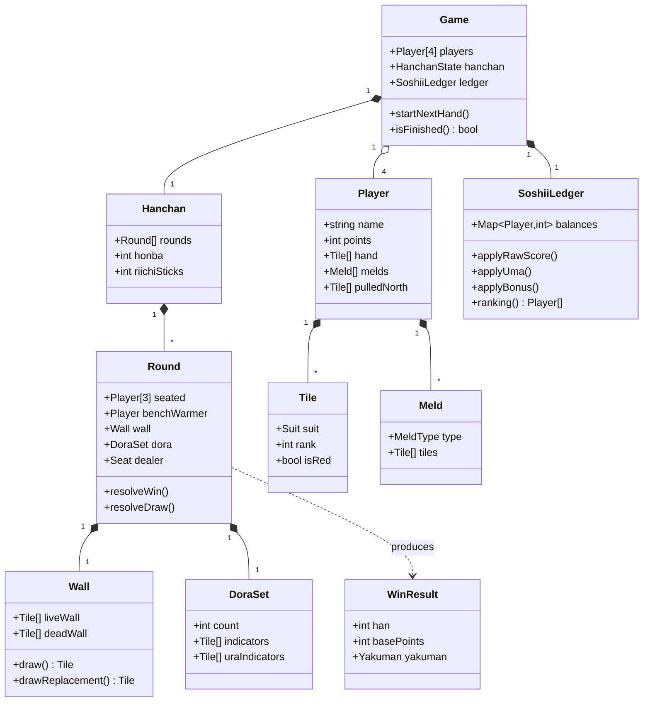

# スペック4: ドメインモデル

対象: ゲームロジックのドメイン(値オブジェクト/エンティティ)。実装は Domain 層に置き、UI・永続化から独立させる(DDD 層規律)。

## 4.1 クラス図(概観)

## 4.2 値オブジェクト / 列挙

| 型 | 内容 |
|---|---|
| `Suit` | `MAN` \| `PIN` \| `SOU` \| `HONOR` |
| `Tile` | `{ suit, rank, isRed }`。5筒/5索は常に `isRed=true`。萬子は rank ∈ {1,9} のみ |
| `MeldType` | `PON` \| `KAN`(チーなし) |
| `Yakuman` | 通常役満 / パオ対象(大三元・大四喜・四槓子) |
| `Seat` | 着席3人の席(東/南/西)。抜け番は席を持たない |

## 4.3 エンティティの責務(RDD)

| エンティティ | 責務 |
|---|---|
| `Game` | 4プレイヤー・半荘・ソシー台帳の統括。終了判定・抜け番交代の起点 |
| `Hanchan` | 局列・本場・供託の管理 |
| `Round` | 1局の進行(配牌・打牌・鳴き・北抜き・和了/流局判定) |
| `Player` | 手牌・鳴き・抜き北・**持ち点(局をまたいで永続)** の保持 |
| `Wall` | 108枚の山・王牌・嶺上・ドラ表示の供給 |
| `DoraSet` | サイコロ出目から枚数決定、表/裏ドラ表示の保持 |
| `SoshiiLedger` | 素点+ウマ+祝儀のソシー累計と順位算出 |

## 4.4 不変条件(Invariants)

- 牌の総数は常に108枚(山+手牌+捨牌+晒し+王牌+抜き北 の合計)。
- `Player.points` は抜け番中に変化しない。
- `DoraSet.count` は 1〜3 のいずれか。裏ドラ枚数は表と同数。
- 赤5は5筒・5索に限る。

**完了基準**
- [ ] 上記型・エンティティが Domain 層に定義される(UI/DB非依存)
- [ ] 不変条件がテストで担保される(TestDD: Domain ユニット優先)

> 注: `Round.seated / benchWarmer / dealer` の決定規則(抜け番順・席割り・親)は `質問リスト.md` Q9〜Q11 の確定後に実装する。モデル上の型は先に用意してよいが、決定ロジックは未確定。
