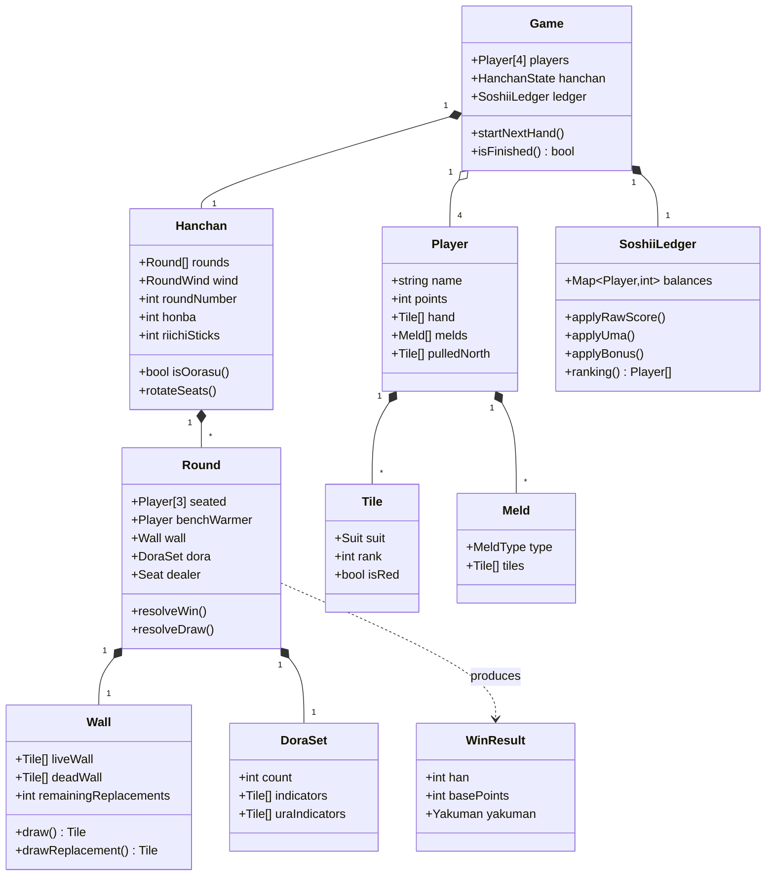

# スペック4: ドメインモデル

対象: ゲームロジックのドメイン(値オブジェクト/エンティティ)。実装は Domain 層に置き、UI・永続化から独立させる(DDD 層規律)。

## 4.1 クラス図(概観)

## 4.2 値オブジェクト / 列挙

| 型 | 内容 |
|---|---|
| `Suit` | `MAN` \| `PIN` \| `SOU` \| `HONOR` |
| `Tile` | `{ suit, rank, isRed }`。5筒/5索は常に `isRed=true`。萬子は rank ∈ {1,9} のみ |
| `MeldType` | `PON` \| `KAN`(チーなし) |
| `Yakuman` | 通常役満 / パオ対象(大三元・大四喜・四槓子) |
| `Seat` | 着席3人の席(東/南/西)。抜け番は席を持たない(北=抜け番) |
| `RoundWind` | `EAST` \| `SOUTH`(場。東南戦) |

## 4.3 エンティティの責務(RDD)

| エンティティ | 責務 |
|---|---|
| `Game` | 4プレイヤー・半荘・ソシー台帳の統括。終了判定・抜け番交代の起点 |
| `Hanchan` | 局列・場(東/南)・局番号・本場・供託の管理。席回転(北家抜けモデル)とオーラス判定 |
| `Round` | 1局の進行(配牌・打牌・鳴き・北抜き・和了/流局判定) |
| `Player` | 手牌・鳴き・抜き北・**持ち点(局をまたいで永続)** の保持 |
| `Wall` | 108枚の山・王牌・嶺上の供給。ドラ表示牌は**領域を確保するだけ**で供給しない(選定は `DoraSet` / #386) |
| `DoraSet` | サイコロ出目から枚数決定、表/裏ドラ表示の保持 |
| `SoshiiLedger` | 素点+ウマ+祝儀のソシー累計と順位算出 |

## 4.4 不変条件(Invariants)

- 牌の総数は常に108枚(山+手牌+捨牌+晒し+王牌+抜き北 の合計)。
- `Player.points` は抜け番中に変化しない。
- `DoraSet.count` は 1〜3 のいずれか。裏ドラ枚数は表と同数。
- 赤5は5筒・5索に限る。
  > この不変条件の**唯一の定義元**は `src/domain/tiles/tile.ts`(issue #375 / #379 / #485)。同ファイル内の内部式 `isRedFiveKind(suit, rank)` を、次の2つの公開関数が共有する。
  > - **生成**: `createTile(suit, rank)` — 牌種から `Tile` を組み立て `isRed` を確定させる。牌種から `Tile` を作る本番処理は UI 境界を含めてこのファクトリを経由し、`{ suit, rank, isRed: … }` を直に書かない。
  > - **判定**: `isRedDora(tile)` — 既存の値が赤ドラかを判定する。`Tile` は実行時検証を持たない構造型で、`createTile` を経由しない値(復元データ・外部入力・表示用 `TileData`)は仕様外の `isRed` を持ち得るため、**牌種を確認せず `tile.isRed` を信じない**。得点(`domain/dora/han.ts` の赤ドラ翻)・表示(`components/common/` の色付き素材・赤枠・バッジ・`aria-label`)・AI の打点温存(`domain/game/ai.ts` の `valueOf` / issue #490)はこの述語を共有し、同じ入力に同じ答えを返す。
  >
  > `src/domain/tiles/tile-factory.regression.test.ts` が3本の検出器でこれを機械的に検査する。(1) `Tile` の組み立て(`isRed:` リテラル)は `src/domain/` を、(2) 赤5判定の再実装は `src/domain/` に加えて `src/components/` `src/app/` を走査する(表示層まで広げたのは、そこでの重複が issue #485 の原因だったため)。(3) **`.isRed` の直読み**は (2) と同じ走査ルートで検出し、フラグの値そのものを扱う正当な用途(同一性比較・識別キー・整列・投影・保存値の検証)だけを許可リスト `ALLOWED_RAW_IS_RED_READS` に**該当行の完全一致**で固定する(issue #490)。許可箇所が増えても、逆に許可リストから根拠が消えても落ちる。例外はテスト専用の独立オラクル `src/domain/hand/__oracle__/`(本番へ依存しないことが検証価値の源泉のため、意図的に重複させる)。
  > いずれも字面の走査なので、別名束縛や `Object.entries` 経由の読み出しはすり抜ける(分割代入 `const { isRed } = tile` は `src/domain/` に限り (1) が拾う)。3本は**多層防御**であって、単体でも合計でも完全性を主張するものではない。
  > UI の操作入力は `suit` / `rank` を正として `createTile` で `isRed` を正規化する。一方、`sessionStorage` の復元ジャーナルは保存済み `isRed` が `createTile` の結果と一致する場合だけ受理する。矛盾した旧データを黙って修復・再生すると保存時と異なる操作になるため、破損データとして fail-closed で拒否し、新規対局へフォールバックする(issue #379)。
- 常に着席3人(東/南/西)+抜け番1人の計4人。`benchWarmer` は席(`Seat`)を持たない。
- 抜け番は**直前局の親**(親流れ時)。連荘中は席・抜け番・`roundNumber` を据え置く。
- `Hanchan.roundNumber` は 1〜4(各場4局)。`wind ∈ {EAST, SOUTH}`。オーラス = `wind=SOUTH ∧ roundNumber=4`。

## 4.5 席・親・抜け番の回転規則(北家抜けモデル)(Q9〜Q11)

`Round.seated / benchWarmer / dealer` の決定規則(spec 2.5・2.6 と同一の SSOT):

- **親流れ時のみ**、反時計回りに1席回転する:
  - 旧東(退位親) → 北(抜け番)、旧南 → 東(新親)、旧西 → 南、旧北(抜け番) → 西(復帰)。
- **連荘時(親テンパイ/親和了)は回転せず**、席・抜け番・`roundNumber` を据え置き、`honba += 1`。
- **場・局進行**: 東1→…→東4→南1→…→南4(各場4局)。親流れごとに `roundNumber += 1`、南4完了で場交代/半荘終了。
- **初期席・起家**は掴み取り/サイコロで決定するが**見た目のみの演出**(誰を初期の北=抜け番にするかを決めるだけ。ゲーム性に影響なし)。

擬似コード(親流れ時)は spec 2.5 を参照。持ち点(`Player.points`)は席回転・抜け番で移動しない(Q5)。

**完了基準**
- [ ] 上記型・エンティティが Domain 層に定義される(UI/DB非依存)
- [ ] 不変条件がテストで担保される(TestDD: Domain ユニット優先)
- [ ] 4.5 の回転規則(親流れ回転・連荘据え置き・場/局進行)が実装され、席・親・抜け番・場・局が正しく遷移する
