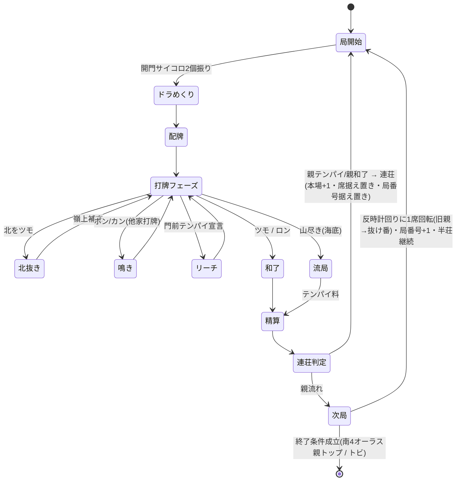
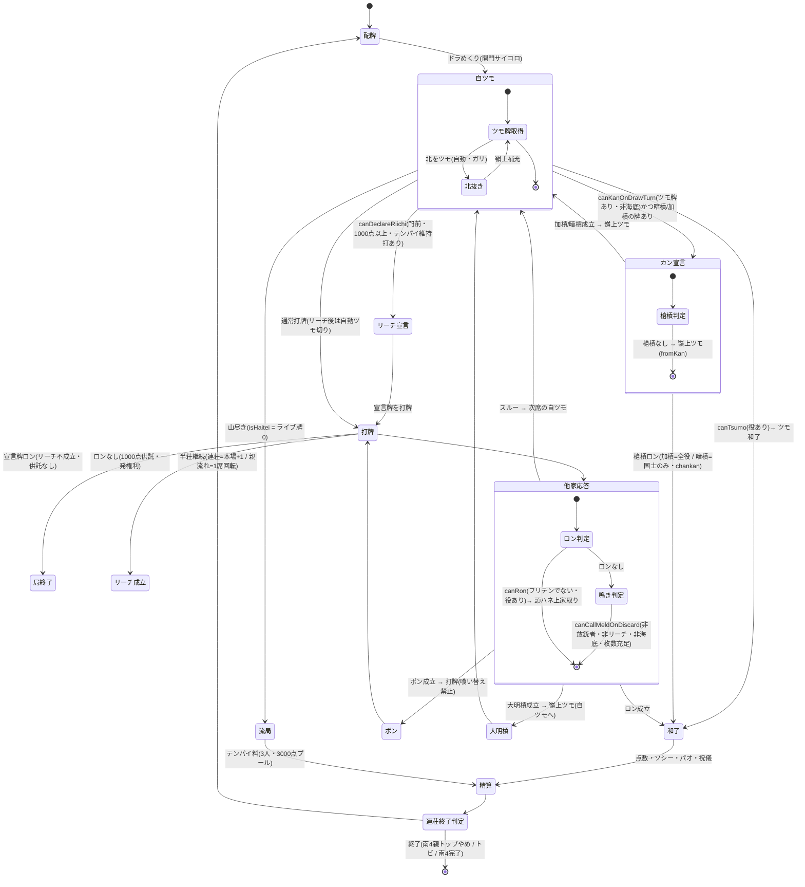

# スペック2: 局の進行・北抜き・ドラめくり・連荘・終了

対象: 1局の状態遷移と、進行中に発生する操作・イベント。

## 2.1 局の状態遷移



### 2.1.1 アクション可否述語(can_*)を明示した詳細遷移

2.1 の各遷移で「その操作を宣言できるか(可否)」を判定する述語を明示した詳細図。
実装(`src/domain/game/engine.ts`)は可否を純述語へ切り出しており、**境界(海底・リーチ中・
鳴き後・放銃者自身・非門前・点棒不足)を単体検証できる**(issue #139 / 設計参考: OpenRiichi の
`RoundState.can_*` = 壁レベルのガード × プレイヤーレベルの可否の分解。GPL のためコードは非流用・
設計思想のみ参照)。



**可否述語 → 実装の対応**(engine.ts の公開純述語)

| 局面 | 述語 | 主なガード |
|---|---|---|
| 海底 | `isHaitei(remainingLiveTiles)` | ライブ牌0(嶺上補充不可 → カン・鳴き不可) |
| ポン/大明槓(他家打牌) | `canCallMeldOnDiscard` | 放銃者自身×・リーチ後×・海底×・枚数(ポン2/槓3)、赤フラグ無視の種別一致 |
| 暗槓/加槓(自ツモ番) | `canKanOnDrawTurn` | ツモ牌あり・非海底(牌種の有無は候補列挙が別判定) |
| リーチ | `canDeclareRiichi` | 自ツモ番・門前(暗槓のみは門前)・1,000点以上・テンパイ維持打あり |
| リーチ後暗槓 | `canAnkanAfterRiichi` | ツモ牌の暗刻4枚目・待ち不変・送り槓でない(Q18 / §2.4) |
| ツモ和了 | `analyzeTsumo(...) !== null` | 役あり(海底摸月・嶺上開花・一発等を含む) |
| ロン和了 | `analyzeRon(...) !== null`(`canRon`) | フリテンでない・役あり(河底撈魚・槍槓を含む) |

> ロン/ツモ自体は海底(海底摸月・河底撈魚)でも可(役として成立)。「海底不可」はカン・鳴きのみ。

> **嶺上牌のツモは海底摸月ではない**(#396)。海底摸月は「ライブ壁の最後の1枚を自摸した」ことが条件であり、嶺上補充でライブ牌が 0 になっても付かない。これは**カンの嶺上補充だけでなく北抜き(ガリ)の嶺上補充にも等しく適用**する。一方 **嶺上開花は槓の嶺上牌に限る**(→ スペック3 3.2)ため、北抜きの嶺上牌には付かない。
>
> 北抜きが**海底でも可能か**(嶺上補充で王牌が14→13枚に減ることを許すか)は `質問リスト.md` **Q33 が未回答**のため現状維持(可能)。上記の役判定は Q33 の裁定とは独立に成立する。

## 2.2 ドラめくり(各局)

- 各局の**開門位置を決めるサイコロ(2個振り)の出目**で表ドラ枚数が変動する。
- 判定:
  | 出目 | 表ドラ枚数 |
  |---|---|
  | 通常(ゾロ目でない) | 1枚 |
  | ゾロ目 | 2枚 |
  | 6のゾロ目(6・6)のみ | 3枚 |
- **リーチ時の裏ドラ**は、その局の**表ドラと同じ枚数**乗る(Q7)。表ドラ表示牌は局中つねに公開、**裏ドラ表示牌はリーチ和了時のみ開示**する。

### 王牌内のドラ表示牌の位置

ドラ表示牌は**王牌(`Wall.deadWall`、14枚)から選定**する。表ドラ枚数 `count`(1〜3、上表)に対し:

- 王牌**先頭**から **表ドラ表示牌を `count` 枚**、続けて **裏ドラ表示牌を `count` 枚** 取る(表 → 裏の順)。
- `i` 番目の表ドラ表示牌と `i` 番目の裏ドラ表示牌が**対応**する(同順)。
- 表示牌は最大 `3 + 3 = 6` 枚で、王牌14枚に必ず収まる。
- ドラ表示牌は**局開始時のスナップショット**であり、以後の北抜き・嶺上補充で王牌が消費されても変化しない。

#### 表示牌と嶺上供給の位置関係(#386)

王牌14枚は用途で2つの領域に分かれ、**嶺上牌は表示牌の領域から供給しない**。

| 領域 | 枚数 | 用途 |
|---|---|---|
| 表示牌の確保領域(先頭側) | `2 × 表ドラ枚数の上限` = **6** | 表 `count` 枚 + 裏 `count` 枚を取る。`count` が上限未満でも6枚を確保する(王牌の構築時点では出目=`count` が未確定のため) |
| 嶺上供給領域(末尾側) | `14 − 6` = **8** | 嶺上補充はここの末尾から供給し、ライブ壁からの補填はここの先頭へ入る |

- **場に晒された表示牌(表・裏)は、同一局の間、どのプレイヤーの手にも渡らない。** 供給と補填が嶺上供給領域の内側で閉じているため、表示牌が押し出されて配られることは構造的に起きない。
- 嶺上補充はライブ壁から補填されるため、**ライブ壁が残る限り補充回数に上限は無く、嶺上供給領域も減らない**。供給領域が実際に減るのは**海底(ライブ牌0で補填が入らない)での補充**だけである。尽きた場合は表示牌を配らずエラーにする。
- 嶺上供給領域の 8 枚は、1局で発生し得る嶺上補充の上限を無条件に賄うための**設計上の安全側の見積り**である。その上限は **北抜き 4**(北は4枚)+ **カン 4** = 8 で、8枚とちょうど一致する(余裕ゼロ)。
  - カンの上限 4 を駆動しているのは、**1人の手牌に作れる面子は最大4つ**(14枚 = 4面子 + 雀頭)であることである。**1人四槓**は四槓子の機会を残すため散了せず、この4回ぶんの嶺上を引ける(四槓散了のしきい値には依存しない)。複数家にまたがる経路は散了しきい値の1つ手前まで(= 3回)で、散了判定は嶺上補充より先に行われるため散了させたカンは嶺上を引かない。四槓散了のしきい値がたまたま同じ 4 なのは**偶然の一致**であり、しきい値を上げる場合は `散了しきい値 − 1 <= 手牌の面子上限` を再確認すること。
  - 守るべき不変条件は `王牌枚数 − 表示牌の確保枚数 >= 1局の嶺上補充上限`。王牌枚数・表ドラ上限・カン上限のいずれかを変える場合は必ず再検証すること(`src/domain/integration/dead-wall-budget.integration.test.ts` で固定)。
- 王牌枚数は「0(王牌なし)」か「表示牌の確保枚数(6)以上」の**整数**でなければならない。1〜5 では嶺上を1枚も供給できないため、構築時にエラーとする。

> 次牌写像(表示牌 → 実ドラ)は→ スペック3 3.2。実装は `src/domain/dora/doraSet.ts`(選定)・`indicator.ts`(写像)。

**受け入れ基準**
- Given 局開始 / When 出目が (3,5) / Then 表ドラ1枚・裏ドラ1枚
- Given 局開始 / When 出目が (4,4) / Then 表ドラ2枚・裏ドラ2枚
- Given 局開始 / When 出目が (6,6) / Then 表ドラ3枚・裏ドラ3枚
- Given 出目が (4,4)(count=2) / When 王牌先頭から選定 / Then 表ドラ表示牌=先頭2枚・裏ドラ表示牌=続く2枚(表→裏の順・同順対応)
- Given 出目が (6,6)(count=3・表示牌6枚) / When 上限(8回)まで嶺上補充する / Then 配られた嶺上牌は表ドラ/裏ドラ表示牌のいずれとも別の牌である(#386)
- Given 嶺上供給領域が尽きた / When さらに嶺上補充を要求 / Then 表示牌は配らずエラーにする(#386)

## 2.3 北抜き(ガリ)

- 北を**ツモ**したら手牌から抜いて場に晒し、**嶺上牌を補充**する。
- 和了時、**抜いた北の枚数分がドラ**として加算される(赤・表ドラと別枠で加算)。
- 抜いた北はロン牌にならない(場に晒された抜きドラ扱い)。

**完了基準**
- [ ] 北ツモ時に抜き→嶺上補充ができる
- [ ] 抜いた枚数が和了点に1枚1翻で加算される

## 2.4 鳴き・リーチ・フリテン

| 項目 | ルール |
|---|---|
| 鳴き | ポン・カン(チーなし) |
| リーチ | 門前テンパイで宣言。リーチ棒1,000点は供託 |
| フリテンリーチ | **あり。ただしツモ和了のみ可**(ロン不可) |
| 捨て牌フリテンの範囲 | 自分が**打った牌すべて**(恒久 / #395)。他家にポン・明槓された牌は河(表示)から取り除かれるが、打った事実は消えないためフリテンの対象として残る。判定の入力は「表示上の河」ではなく**打牌履歴**である |
| ダブロン | **なし。頭ハネ(上家取り)** |
| 供託・本場 | ダブロン相当時も上家が取得 |
| 喰い替え(現物) | **禁止**(スペック1 1.4 / #105)。ポン直後にポンした牌と同種を切る=現物喰い替えは非合法手として拒否(サンマはチー無しのため現物喰い替えのみ) |
| 槍槓(チャンカン) | **確定(ユーザー承認・槍槓あり / Q17・#115)**。加槓宣言時、その加槓牌でロンできる他家がいれば加槓は不成立(牌は手に戻らず横取り)= 槍槓ロン(`chankan` 1翻)として精算する。加槓者は放銃者として支払う。頭ハネ(上家取り)は通常ロンと同じ順で最先の1人が和了。フリテン・役判定は通常ロンと同じ(`chankan` 役が付くため役なしにはならない) |
| 国士無双の暗槓槍槓 | **確定(Q17 フォローアップ・#126・ユーザー承認・国士のみ暗槓槍槓可)**。通常の槍槓は加槓のみ対象だが、**国士無双テンパイの他家に限り**、暗槓(4枚目を暗槓した瞬間)に対しても槍槓ロンを認める。応答者の和了形が**国士無双**の場合のみ横取りが成立し、暗槓は不成立(暗槓者が放銃者として支払う)。国士以外の手(標準/七対子)では暗槓に対する槍槓は不可(暗槓成立)。フリテン・頭ハネは通常ロンと同じ(`ronOrder` / `analyzeRon` を再利用)。国士以外の派生規則は SSOT 未記載のためスコープ外 |
| リーチ後の暗槓 | **確定(Q18 / #116・ユーザー承認・条件付き許可 / 標準慣行)**。リーチ後は原則自動ツモ切りだが、**ツモ牌での暗槓**に限り、暗槓しても **① 待ち(和了牌の種別集合)が変わらず ② その4枚が全ての和了形で門前の暗刻として確定**している場合のみ許可する。送り槓(待ち・受け・面子構成が変わる槓)は不可。**七対子テンパイでの暗槓も不可**(暗刻が存在せず ② を満たさない)。四兄弟麻雀は新ドラ(カンドラ)を持たない(ドラ枚数は開門サイコロで確定・§4.1)ため暗槓による新ドラめくりは無い |

**受け入れ基準**
- Given フリテン状態でリーチ / When 当たり牌をロン / Then 和了不可(チョンボ扱いにしない=見逃し)
- Given フリテン状態でリーチ / When 当たり牌をツモ / Then 和了成立
- Given 自分の待ち牌を打つ / When その牌を他家にポン・明槓され河から取り除かれる / Then 捨て牌フリテンは解除されずロン不可のまま(#395)
- Given 2人が同時ロン / When 精算 / Then 上家1人のみ和了(頭ハネ)
- Given ポン直後の打牌フェーズ / When ポンした牌と同種を切ろうとする / Then 非合法手として拒否(no-op・現物喰い替え禁止)
- Given ポン直後の打牌フェーズ / When 同種以外の牌を切る / Then 通常どおり打牌が成立し進行する
- Given 加槓を宣言 / When その加槓牌でロンできる他家がいる / Then 加槓は不成立(横取り)= 槍槓ロン成立(`chankan` 1翻・加槓者が放銃者)
- Given 加槓を宣言 / When 加槓牌でロンできる他家が複数いる / Then 頭ハネ(上家取り・通常ロンと同順)で最先の1人のみ和了
- Given 加槓を宣言 / When 加槓牌が他家のフリテン牌(またはロン形にならない) / Then 槍槓は成立せず加槓続行 → 嶺上ツモへ進む
- Given 暗槓を宣言 / When その暗槓牌で**国士無双**が和了できる他家がいる / Then 暗槓は不成立(横取り)= 槍槓ロン成立(暗槓者が放銃者)
- Given 暗槓を宣言 / When 暗槓牌でロンできる他家がいるが和了形が**国士以外**(標準/七対子) / Then 槍槓は成立せず暗槓成立 → 嶺上ツモへ進む
- Given 暗槓を宣言 / When 暗槓牌が国士テンパイ者の待ち牌でない(または当該他家がフリテン) / Then 槍槓は成立せず暗槓成立 → 嶺上ツモへ進む
- Given リーチ中に手牌の暗刻の4枚目をツモ(暗槓しても待ち・面子構成が不変)/ When 暗槓 / Then 暗槓が成立し嶺上ツモへ進む(新ドラめくりは無し)
- Given リーチ中のツモ牌が送り槓(暗槓で待ち・面子構成が変わる)になる / When 暗槓を試みる / Then 非合法手として拒否(暗槓は提示されない=自動ツモ切りのまま)
- Given 七対子テンパイでリーチ / When ツモ牌で暗槓を試みる / Then 暗槓不可(暗刻が無く提示されない)

## 2.5 席・親・抜け番の回転(北家抜けモデル)(Q9・Q10)

四人回し(rule §1)を**北家抜けの回転モデル**で表現する。

- 常時 **東(親)/南/西 が着席**し、**北にあたる1人が抜け番**(北家=抜け番)。抜け番の `Player.points` は不変(Q5・4.4)。
- **親流れ(非連荘)時のみ、反時計回りに全員が1席回転**する:

  | 局N の席 | → | 局N+1 の席 |
  |---|---|---|
  | 東(退位した親) | → | 北(抜け番) |
  | 南 | → | 東(新親) |
  | 西 | → | 南 |
  | 北(それまでの抜け番) | → | 西(復帰) |

- したがって **抜け番=「直前局の親」**。復帰は必ず西からで、以後 西→南→東(親)→北(抜け番) の順で巡る。
- **初期席・起家**は掴み取り/サイコロで決定するが、**ゲーム性への影響はなく見た目のみの演出**(最初に誰を北=抜け番に置くかを決めるだけ)。実装は任意の初期割当でよい。

**擬似アルゴリズム(親流れ時の回転)**

```
rotate(round):
  newDealerEast = round.seat.south          # 旧南が新親(東)
  newSouth      = round.seat.west            # 旧西→南
  newWest       = round.benchWarmer          # 旧北(抜け番)が復帰→西
  newBench      = round.seat.east            # 旧東(退位親)が抜け番(北)へ
```

## 2.6 場の進行(東南戦)とオーラス(Q11)

- 半荘は**東南戦**。進行は **東1 → 東2 → 東3 → 東4 → 南1 → 南2 → 南3 → 南4**。
- **各場4局**で、4人が親を1巡する(1局ごとに 2.5 の回転で親交代)。
- **オーラス = 南4局**。
- **連荘時は局番号を進めない**(例: 東1で親連荘 → 東1・1本場。席・抜け番も据え置き)。本場のみ加算。

## 2.7 連荘・積み棒

- **東場・南場ともに親はテンパイで連荘**(親和了でも連荘)。
- 積み棒(本場)あり。連荘・流局で本場+1。
- **連荘時は席・抜け番・局番号を据え置く**(2.5 の回転を行わない)。本場のみ +1。

## 2.8 終了条件

半荘は**東南戦(東場・南場)**。以下いずれかで終了する。

1. **オーラス(南4局)で親が3万点を超えてトップ** → その時点で終了(和了やめ/テンパイやめ相当)。南4局以外では発火しない。ここでの「トップ」は **抜け番を含む4兄弟全員の持ち点に対する単独最高**(かつ >30,000)を指す(**Q19 確定・ユーザー承認**)。抜け番(その局は対局外の第4者)の持ち点も比較対象に含め、**同点最高は「単独トップ」ではないため終了せず継続**する。抜け番が親を真に上回る場合も親はトップでないため継続。
2. **トビ**: いずれかのプレイヤーの持ち点が**マイナス**に達した時点で半荘即終了(任意の局で発火)。
3. 上記以外で南4局が親流れ(または非トップ和了)で終わった場合も、南4完了をもって半荘終了。

**受け入れ基準**
- Given 南4局(オーラス)親番 / When 親が和了して持ち点>30,000かつ抜け番含む全員に対し単独最高 / Then 半荘終了
- Given 南4局(オーラス)親番 / When 親>30,000だが最高点と同点(単独最高でない) / Then 半荘は継続(親トップやめ不成立)
- Given 南4局(オーラス)親番 / When 抜け番の持ち点が親より高い / Then 半荘は継続(親はトップでない)
- Given 東1〜南3のいずれか / When 親が3万超えトップで和了 / Then 半荘は継続(オーラス以外では終了しない)
- Given 任意の局 / When あるプレイヤーの持ち点<0 / Then 半荘即終了(トビ)
- Given 東1で親連荘 / When 次局開始 / Then 局番号は東1のまま・本場+1・席据え置き
- Given 東1で親流れ / When 次局開始 / Then 東2へ進み反時計回りに1席回転(旧親が抜け番)

**完了基準**
- [ ] 状態遷移図の全経路が実装され、和了/流局/連荘/終了が処理される
- [ ] 北家抜けの回転(2.5)と場進行(2.6)が実装され、席・親・抜け番が正しく遷移する
- [ ] 終了条件が判定される(南4オーラス親トップ / トビ / 南4完了)
