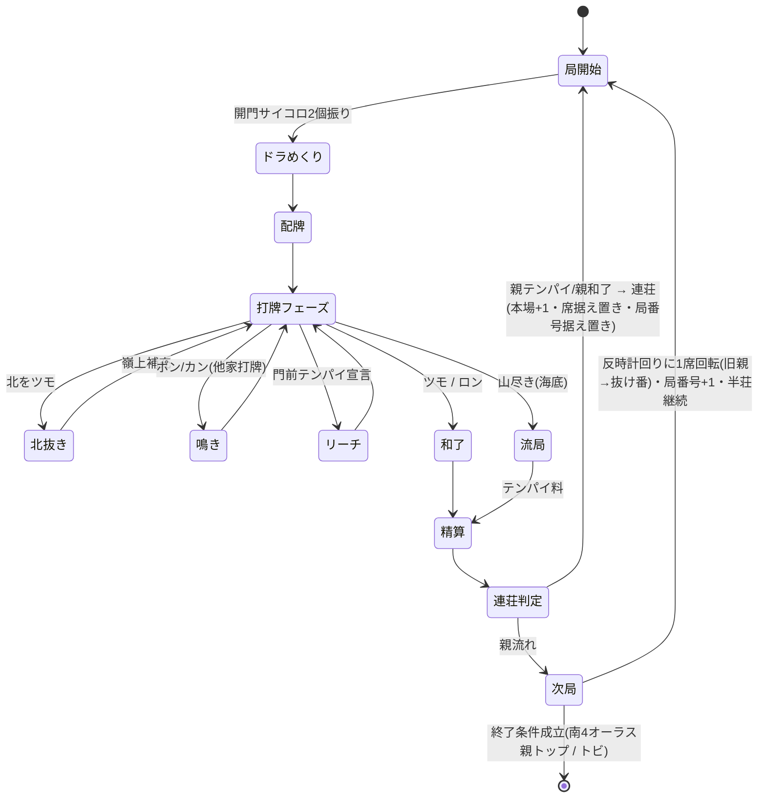

# スペック2: 局の進行・北抜き・ドラめくり・連荘・終了

対象: 1局の状態遷移と、進行中に発生する操作・イベント。

## 2.1 局の状態遷移



## 2.2 ドラめくり(各局)

- 各局の**開門位置を決めるサイコロ(2個振り)の出目**で表ドラ枚数が変動する。
- 判定:
  | 出目 | 表ドラ枚数 |
  |---|---|
  | 通常(ゾロ目でない) | 1枚 |
  | ゾロ目 | 2枚 |
  | 6のゾロ目(6・6)のみ | 3枚 |
- **リーチ時の裏ドラ**は、その局の**表ドラと同じ枚数**乗る(Q7)。表ドラ表示牌は局中つねに公開、**裏ドラ表示牌はリーチ和了時のみ開示**する。

### 王牌内のドラ表示牌の位置

ドラ表示牌は**王牌(`Wall.deadWall`、14枚)から選定**する。表ドラ枚数 `count`(1〜3、上表)に対し:

- 王牌**先頭**から **表ドラ表示牌を `count` 枚**、続けて **裏ドラ表示牌を `count` 枚** 取る(表 → 裏の順)。
- `i` 番目の表ドラ表示牌と `i` 番目の裏ドラ表示牌が**対応**する(同順)。
- 表示牌は最大 `3 + 3 = 6` 枚で、王牌14枚に必ず収まる。
- ドラ表示牌は**局開始時のスナップショット**であり、以後の北抜き・嶺上補充で王牌が消費されても変化しない。

> 次牌写像(表示牌 → 実ドラ)は→ スペック3 3.2。実装は `src/domain/dora/doraSet.ts`(選定)・`indicator.ts`(写像)。

**受け入れ基準**
- Given 局開始 / When 出目が (3,5) / Then 表ドラ1枚・裏ドラ1枚
- Given 局開始 / When 出目が (4,4) / Then 表ドラ2枚・裏ドラ2枚
- Given 局開始 / When 出目が (6,6) / Then 表ドラ3枚・裏ドラ3枚
- Given 出目が (4,4)(count=2) / When 王牌先頭から選定 / Then 表ドラ表示牌=先頭2枚・裏ドラ表示牌=続く2枚(表→裏の順・同順対応)

## 2.3 北抜き(ガリ)

- 北を**ツモ**したら手牌から抜いて場に晒し、**嶺上牌を補充**する。
- 和了時、**抜いた北の枚数分がドラ**として加算される(赤・表ドラと別枠で加算)。
- 抜いた北はロン牌にならない(場に晒された抜きドラ扱い)。

**完了基準**
- [ ] 北ツモ時に抜き→嶺上補充ができる
- [ ] 抜いた枚数が和了点に1枚1翻で加算される

## 2.4 鳴き・リーチ・フリテン

| 項目 | ルール |
|---|---|
| 鳴き | ポン・カン(チーなし) |
| リーチ | 門前テンパイで宣言。リーチ棒1,000点は供託 |
| フリテンリーチ | **あり。ただしツモ和了のみ可**(ロン不可) |
| ダブロン | **なし。頭ハネ(上家取り)** |
| 供託・本場 | ダブロン相当時も上家が取得 |
| 喰い替え(現物) | **禁止**(スペック1 1.4 / #105)。ポン直後にポンした牌と同種を切る=現物喰い替えは非合法手として拒否(サンマはチー無しのため現物喰い替えのみ) |
| 槍槓(チャンカン) | **未確定(Q17 / #105 フォローアップ)**。加槓に対する他家の横取り和了を提示するかは SSOT に明記がなく一意に定まらないため未実装。現状は加槓後そのまま嶺上ツモへ進む |
| リーチ後の暗槓 | **未確定(Q18 / #105 フォローアップ)**。リーチ後の暗槓可否・条件は SSOT に明記がなく一意に定まらないため不可。現状はリーチ後を自動ツモ切りに固定 |

**受け入れ基準**
- Given フリテン状態でリーチ / When 当たり牌をロン / Then 和了不可(チョンボ扱いにしない=見逃し)
- Given フリテン状態でリーチ / When 当たり牌をツモ / Then 和了成立
- Given 2人が同時ロン / When 精算 / Then 上家1人のみ和了(頭ハネ)
- Given ポン直後の打牌フェーズ / When ポンした牌と同種を切ろうとする / Then 非合法手として拒否(no-op・現物喰い替え禁止)
- Given ポン直後の打牌フェーズ / When 同種以外の牌を切る / Then 通常どおり打牌が成立し進行する

## 2.5 席・親・抜け番の回転(北家抜けモデル)(Q9・Q10)

四人回し(rule §1)を**北家抜けの回転モデル**で表現する。

- 常時 **東(親)/南/西 が着席**し、**北にあたる1人が抜け番**(北家=抜け番)。抜け番の `Player.points` は不変(Q5・4.4)。
- **親流れ(非連荘)時のみ、反時計回りに全員が1席回転**する:

  | 局N の席 | → | 局N+1 の席 |
  |---|---|---|
  | 東(退位した親) | → | 北(抜け番) |
  | 南 | → | 東(新親) |
  | 西 | → | 南 |
  | 北(それまでの抜け番) | → | 西(復帰) |

- したがって **抜け番=「直前局の親」**。復帰は必ず西からで、以後 西→南→東(親)→北(抜け番) の順で巡る。
- **初期席・起家**は掴み取り/サイコロで決定するが、**ゲーム性への影響はなく見た目のみの演出**(最初に誰を北=抜け番に置くかを決めるだけ)。実装は任意の初期割当でよい。

**擬似アルゴリズム(親流れ時の回転)**

```
rotate(round):
  newDealerEast = round.seat.south          # 旧南が新親(東)
  newSouth      = round.seat.west            # 旧西→南
  newWest       = round.benchWarmer          # 旧北(抜け番)が復帰→西
  newBench      = round.seat.east            # 旧東(退位親)が抜け番(北)へ
```

## 2.6 場の進行(東南戦)とオーラス(Q11)

- 半荘は**東南戦**。進行は **東1 → 東2 → 東3 → 東4 → 南1 → 南2 → 南3 → 南4**。
- **各場4局**で、4人が親を1巡する(1局ごとに 2.5 の回転で親交代)。
- **オーラス = 南4局**。
- **連荘時は局番号を進めない**(例: 東1で親連荘 → 東1・1本場。席・抜け番も据え置き)。本場のみ加算。

## 2.7 連荘・積み棒

- **東場・南場ともに親はテンパイで連荘**(親和了でも連荘)。
- 積み棒(本場)あり。連荘・流局で本場+1。
- **連荘時は席・抜け番・局番号を据え置く**(2.5 の回転を行わない)。本場のみ +1。

## 2.8 終了条件

半荘は**東南戦(東場・南場)**。以下いずれかで終了する。

1. **オーラス(南4局)で親が3万点を超えてトップ** → その時点で終了(和了やめ/テンパイやめ相当)。南4局以外では発火しない。ここでの「トップ」は **抜け番を含む4兄弟全員の持ち点に対する単独最高**(かつ >30,000)を指す(**Q19 確定・ユーザー承認**)。抜け番(その局は対局外の第4者)の持ち点も比較対象に含め、**同点最高は「単独トップ」ではないため終了せず継続**する。抜け番が親を真に上回る場合も親はトップでないため継続。
2. **トビ**: いずれかのプレイヤーの持ち点が**マイナス**に達した時点で半荘即終了(任意の局で発火)。
3. 上記以外で南4局が親流れ(または非トップ和了)で終わった場合も、南4完了をもって半荘終了。

**受け入れ基準**
- Given 南4局(オーラス)親番 / When 親が和了して持ち点>30,000かつ抜け番含む全員に対し単独最高 / Then 半荘終了
- Given 南4局(オーラス)親番 / When 親>30,000だが最高点と同点(単独最高でない) / Then 半荘は継続(親トップやめ不成立)
- Given 南4局(オーラス)親番 / When 抜け番の持ち点が親より高い / Then 半荘は継続(親はトップでない)
- Given 東1〜南3のいずれか / When 親が3万超えトップで和了 / Then 半荘は継続(オーラス以外では終了しない)
- Given 任意の局 / When あるプレイヤーの持ち点<0 / Then 半荘即終了(トビ)
- Given 東1で親連荘 / When 次局開始 / Then 局番号は東1のまま・本場+1・席据え置き
- Given 東1で親流れ / When 次局開始 / Then 東2へ進み反時計回りに1席回転(旧親が抜け番)

**完了基準**
- [ ] 状態遷移図の全経路が実装され、和了/流局/連荘/終了が処理される
- [ ] 北家抜けの回転(2.5)と場進行(2.6)が実装され、席・親・抜け番が正しく遷移する
- [ ] 終了条件が判定される(南4オーラス親トップ / トビ / 南4完了)
