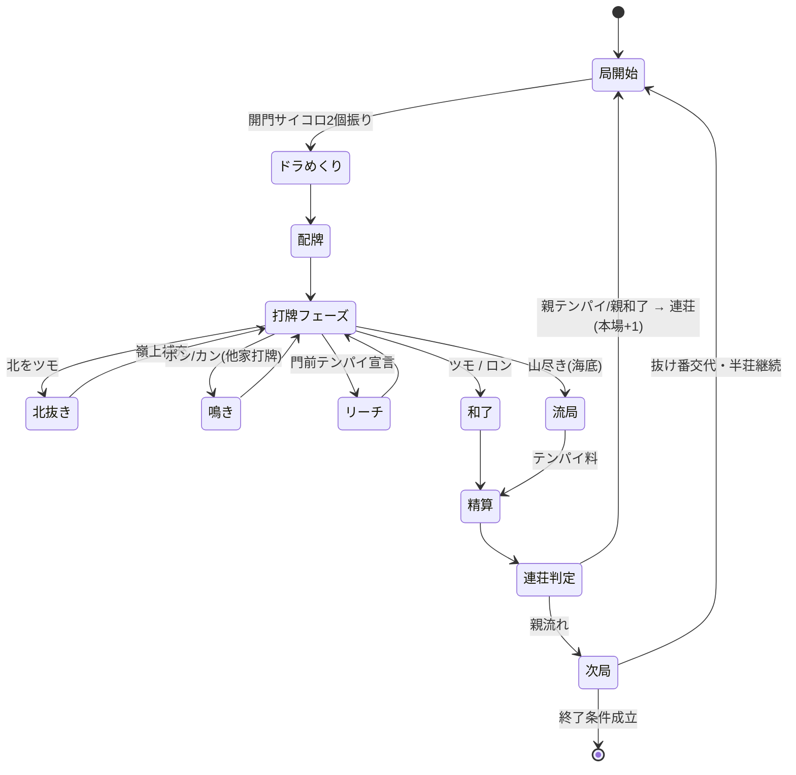

# スペック2: 局の進行・北抜き・ドラめくり・連荘・終了

対象: 1局の状態遷移と、進行中に発生する操作・イベント。

## 2.1 局の状態遷移

## 2.2 ドラめくり(各局)

- 各局の**開門位置を決めるサイコロ(2個振り)の出目**で表ドラ枚数が変動する。
- 判定:
  | 出目 | 表ドラ枚数 |
  |---|---|
  | 通常(ゾロ目でない) | 1枚 |
  | ゾロ目 | 2枚 |
  | 6のゾロ目(6・6)のみ | 3枚 |
- **リーチ時の裏ドラ**は、その局の**表ドラと同じ枚数**乗る(Q7)。表ドラ表示牌は局中つねに公開、**裏ドラ表示牌はリーチ和了時のみ開示**する。

### 王牌内のドラ表示牌の位置

ドラ表示牌は**王牌(`Wall.deadWall`、14枚)から選定**する。表ドラ枚数 `count`(1〜3、上表)に対し:

- 王牌**先頭**から **表ドラ表示牌を `count` 枚**、続けて **裏ドラ表示牌を `count` 枚** 取る(表 → 裏の順)。
- `i` 番目の表ドラ表示牌と `i` 番目の裏ドラ表示牌が**対応**する(同順)。
- 表示牌は最大 `3 + 3 = 6` 枚で、王牌14枚に必ず収まる。
- ドラ表示牌は**局開始時のスナップショット**であり、以後の北抜き・嶺上補充で王牌が消費されても変化しない。

> 次牌写像(表示牌 → 実ドラ)は→ スペック3 3.2。実装は `src/domain/dora/doraSet.ts`(選定)・`indicator.ts`(写像)。

**受け入れ基準**
- Given 局開始 / When 出目が (3,5) / Then 表ドラ1枚・裏ドラ1枚
- Given 局開始 / When 出目が (4,4) / Then 表ドラ2枚・裏ドラ2枚
- Given 局開始 / When 出目が (6,6) / Then 表ドラ3枚・裏ドラ3枚
- Given 出目が (4,4)(count=2) / When 王牌先頭から選定 / Then 表ドラ表示牌=先頭2枚・裏ドラ表示牌=続く2枚(表→裏の順・同順対応)

## 2.3 北抜き(ガリ)

- 北を**ツモ**したら手牌から抜いて場に晒し、**嶺上牌を補充**する。
- 和了時、**抜いた北の枚数分がドラ**として加算される(赤・表ドラと別枠で加算)。
- 抜いた北はロン牌にならない(場に晒された抜きドラ扱い)。

**完了基準**
- [ ] 北ツモ時に抜き→嶺上補充ができる
- [ ] 抜いた枚数が和了点に1枚1翻で加算される

## 2.4 鳴き・リーチ・フリテン

| 項目 | ルール |
|---|---|
| 鳴き | ポン・カン(チーなし) |
| リーチ | 門前テンパイで宣言。リーチ棒1,000点は供託 |
| フリテンリーチ | **あり。ただしツモ和了のみ可**(ロン不可) |
| ダブロン | **なし。頭ハネ(上家取り)** |
| 供託・本場 | ダブロン相当時も上家が取得 |

**受け入れ基準**
- Given フリテン状態でリーチ / When 当たり牌をロン / Then 和了不可(チョンボ扱いにしない=見逃し)
- Given フリテン状態でリーチ / When 当たり牌をツモ / Then 和了成立
- Given 2人が同時ロン / When 精算 / Then 上家1人のみ和了(頭ハネ)

## 2.5 連荘・積み棒

- **東場・南場ともに親はテンパイで連荘**(親和了でも連荘)。
- 積み棒(本場)あり。連荘・流局で本場+1。

## 2.6 終了条件

半荘は**東南戦(東場・南場)**。以下いずれかで終了する。

1. **オーラス(南4局相当)で親が3万点を超えてトップ** → その時点で終了(和了やめ/テンパイやめ相当)。
2. **トビ**: いずれかのプレイヤーの持ち点が**マイナス**に達した時点で半荘即終了。

**受け入れ基準**
- Given オーラス親番 / When 親が和了して持ち点>30,000かつトップ / Then 半荘終了
- Given 任意の局 / When あるプレイヤーの持ち点<0 / Then 半荘即終了(トビ)

> ⚠️ 「場(東/南)」の進行と局ごと交代・親ローテの対応は未確定(`質問リスト.md` Q9〜Q11)。オーラスの厳密な定義は確定後に固める。

**完了基準**
- [ ] 状態遷移図の全経路が実装され、和了/流局/連荘/終了が処理される
- [ ] 終了条件2種が判定される
