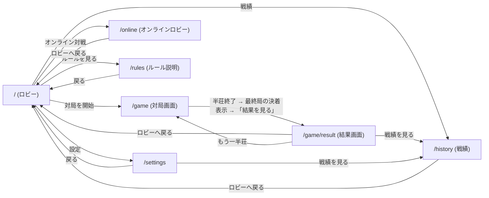

# スペック6: ゲーム画面UI設計とApp Routerルーティング設計

対象: [Issue #8](https://github.com/AutoDevJapan/FourBrosMahjong/issues/8) の受け入れ基準に対応する、対局UIの画面構成・ルーティング・コンポーネント分割の**設計**。
本スペックは **設計のみ** を範囲とし、実装(コード)は含まない。設計合意後、実装は別issue/PRで着手する(#9 がトップページ実装、#30 が対局画面ルートのE2Eを担当予定)。
ゲームドメインのロジック実装(牌山・配牌・和了判定など)は別レーンの責務であり、本スペックの対象外。
アクセシビリティ・レスポンシブ・ダークモードの横断方針は [`ui-accessibility-responsive-darkmode.md`](./ui-accessibility-responsive-darkmode.md)(スペック5)に従う。本スペックの各設計はスペック5の方針を前提とする。

## 6.1 背景

`src/app/` は現状 create-next-app のデフォルトのままで、ゲーム画面・ルーティングは未着手。
ゲームドメインは `documents/spec/setup-and-tiles.md`・`game-flow.md`・`scoring-and-settlement.md`・`domain-model.md`(スペック1〜4)で定義済みであり、**着席3人の席割り当て・抜け番の交代順序・場/親ローテーションの対応(`質問リスト.md` Q9〜Q11)も確定済み**。本スペックはこれらの確定したドメイン境界を前提として、UIがロジックの実装詳細を待たずに組める形で画面・ルーティングを設計する(6.8節参照)。

## 6.2 画面一覧と責務

| 画面 | パス | 責務 | Server/Client |
|---|---|---|---|
| ロビー | `/` | エントリーポイント。ローカル/オンライン対局の開始、ルール説明、設定、戦績への導線を提供する | Server |
| オンラインロビー | `/online` | ルームコードによる接続・退出・再接続と、権威サーバーから受け取ったオンライン対局の表示・操作を提供する | Server shell + Client island |
| ルール説明 | `/rules` | `docs/四兄弟麻雀ルール.md` に基づくルール要約を表示する(閲覧専用) | Server |
| 対局画面 | `/game` | 四人回しサンマの対局本体。卓・各家の手牌/河/得点・ドラ・卓情報・操作パネルを表示する | Server shell + Client island |
| 結果画面 | `/game/result` | 半荘終了時の最終順位・ソシー内訳（素点＋ウマ・オカ＋役満祝儀）を表示する | Server shell + Client island |
| 戦績 | `/history` | `localStorage` に保存されたローカル・オンラインの半荘結果(最終順位・ソシー内訳・終了日時)を新しい順に一覧・閲覧し、全件削除できる(issue #293)。ローカルは `GameProvider`、オンラインはサーバーの確定結果の受信時に自動保存し、混在一覧を直近20件に制限する。全件削除は失敗し得るため、成功したときだけ削除完了として通知する(issue #482 / 6.9) | Server shell + Client island |
| 設定 | `/settings` | ダークモード手動切替(スペック5 5.4.1)と対局者名の設定(6.2.1)、戦績ページへの導線 | Server shell + Client island |

`/prototype/unity-display` は本番の画面遷移には含めない、Unity表示契約のブラウザ・リファレンスである。固定fixtureと実際のWeb表示を比較する検証用画面として、実装ルートとa11y監査の対象には含める。

### 6.2.1 対局者名の設定(issue #291)

四人回しの4人(index 0 = 自家、以降が他家3人)の表示名をユーザーが設定できる。

- **保存先**: `localStorage`(キー `four-bros-mahjong.playerNames.v1`)。同一ブラウザのみで、バックエンド/複数デバイス同期は行わない。
- **既定値**: 固定キャラクター定義の `粗悪品` / `竜二` / `マサキ` / `糸瓜`。未設定・破損・保存不可時、および「既定名に戻す」はこれにフォールバックする。
- **正規化**: 前後の空白を除去し連続空白を1つへ畳む。1人あたり最大12 **書記素クラスタ(grapheme cluster)**で切り詰め、絵文字・結合文字・ZWJ絵文字は見た目の1文字として数える。保存時とフォーム入力中は同じ分割関数を使い、UTF-16のサロゲートペアを分断しない。**ただし IME 変換中(未確定)は上限を適用しない** — ネイティブの `maxlength` は未確定文字列に適用されないのに対しフォームの `onChange` は未確定入力でも発火するため、ここで切り詰めると「日本語入力テスト」(確定後8書記素/読み13書記素)のように**読みだけが上限を超える**入力で変換が壊れる。上限は変換確定時と保存時に適用する。切り詰めの前に半端なサロゲート(lone surrogate)は U+FFFD へ置換するので、出力に lone surrogate は残らない。`Intl.Segmenter` 非対応環境では結合文字・variation selector・emoji modifier・ZWJ列・国旗ペアを保持する決定的fallbackを使う。空欄は既定名で埋める。
- **入力サイズの防御**: 書記素分割は入力長に比例したコストを払うため、分割へ渡す前に UTF-16 code unit の上限(12書記素がどんな構成でも収まる 12×32)で切る。数MBの貼り付けや改竄された保存値を、分割コストを払わずに拒否・切り詰めできる。戦績(6.9)側の防御上限も同じ考え方で持つ(後述)。
- **反映経路**: 保存値は半荘開始時(`/game` 初回描画・「もう一半荘」)に `createGame({ seed, names })` へ渡り、engine の `EnginePlayer.name` として保持される。盤面(`PlayerArea` / `BenchArea`)・結果画面(`RankingTable` / `SoshiiBreakdown`)・読み上げ(`LiveRegion`)へは既存の `selectView` 経由で自動的に反映される。
- **半荘中の変更**: 進行中の半荘の表示名は変わらない。名前は開始時に対局ジャーナル(`sessionStorage`、v2 で `names` を追加)へ固定され、リロード復元時もその名前で再生される。設定変更は**次に開始する半荘**から反映される。
- **ジャーナルの版移行**: 明示北抜きの `kita` actionを含むv3は新key `four-bros-mahjong.game.v3`へだけ保存する。旧clientが読む `four-bros-mahjong.game.v1` keyは移行後も削除・上書きせず、rollbackや新旧タブ共存で旧clientに未知actionを渡さない。v1/v2 action streamは旧版どおり人間席も自動ガリで再生し、成功時にv3へコピーする。v1(`names` 無し)は作成当時の既定名(`あなた` / `一郎` / `二郎` / `三郎`)を補い、新しい既定名へ置換しない。v2の`names`検証・lone surrogateのU+FFFD正規化も維持する。v3の破損・再生失敗・保存失敗はいずれも旧keyを変更してはならない(issue #708)。
- **固定キャラクター**: `p0 = 粗悪品 / 赤`、`p1 = 竜二 / 青`、`p2 = マサキ / 黄`、`p3 = 糸瓜 / 緑`。名前をカスタマイズしても画像・識別色は player ID に結び付き、席・抜け番のローテーションでは入れ替わらない。`糸瓜` の読み仮名は表示しない。設定・対局・結果・新規戦績で同じ対応を使う。
- **名前の重複**: 4人に同じ名前を付けることを禁止しない(ユーザーの自由)。したがって戦績(6.9 / issue #293)の保存レコードも名前の一意性を前提にしてはならず、表示側の React key には名前ではなく順位を使う。
- **戦績側の名前検証**: 戦績(6.9)は**確定済みの表示スナップショット**なので、設定フォームの入力規則(12書記素)を再適用しない。改竄・破損に対する防御として UTF-16 code unit の上限のみを持ち、その値は 12書記素がどんな構成(ZWJ列・tag sequence 等、1書記素が十数 code unit になる場合を含む)でも収まる余裕を取る。設定側の上限を将来下げても保存済みの戦績が無効化されないよう、`MAX_PLAYER_NAME_LENGTH` へは結び付けない。

**受け入れ基準**

- Given 11書記素の名前の末尾へ絵文字を1つ入力 / When 保存して対局を開始し再読み込み / Then 12書記素目の絵文字を分断せず盤面へ同じ名前を表示する(#484)
- Given 絵文字または結合文字を含む名前 / When 12書記素クラスタを超えて入力 / Then 見た目の12文字までを保持し、出力にlone surrogateを含めない(#484)
- Given `Intl.Segmenter` 非対応環境 / When 結合文字・variation selector・emoji modifier・ZWJ列・国旗ペアを含む名前を制限 / Then fallbackが各列を途中で分断しない(#484)
- Given #484 修正前に保存された lone surrogate 入りの名前を含む対局ジャーナル / When リロードして復元する / Then ジャーナルを破棄せず、名前を U+FFFD へ正規化して進行中の半荘を再生する(#484)
- Given 日本語IMEで読みが12書記素を超える語(例: 「にほんごにゅうりょくてすと」→「日本語入力テスト」) / When 変換中に入力して確定する / Then 未確定文字列を切り詰めず変換を壊さない。確定後の文字列にのみ上限を適用する(#484)
- Given 1書記素が複数 code unit になる名前(家族絵文字・国旗・tag sequence)で12書記素 / When 半荘を終えて戦績へ保存する / Then 保存に失敗せず戦績へ残り、`/history` から読み戻せる(#484)

## 6.3 画面遷移



- **半荘終了時の遷移はユーザー操作(ボタン)で行い、自動遷移しない**(#277)。半荘を終える局(トビ / 南4完了 / 親トップやめ)は engine が `roundEnd` を経由せず `gameEnd` へ直行する(スペック2 2.8)ため、`/game` は `gameEnd` でも最終局の決着(和了内訳 `WinDetails`・流局サマリ・各家の点数増減)を表示し、主要ボタン「結果を見る」(push)で `/game/result` へ進む。`/game` は `gameEnd` で自動リダイレクトしないため、結果画面から「戻る」→ `/game`(最終局の決着表示)→「戻る」→ ロビーと履歴トラップなく脱出できる。終局済み journal のリロード復元・ブラウザバックでも同じ決着表示に合流する。**流局で半荘が終わり供託が残存**した場合は、engine が残存供託を最終局デルタへ畳み込み(スペック3 3.4 / #282)、hint・読み上げに「残存供託N本(N,000点)は◯◯が取得。」を併記して持ち点・点数増減・供託カウント0の三者を検算可能に保つ。

## 6.4 対局画面(`/game`)の表示要素とレイアウト設計

### 6.4.1 卓レイアウト(4スロット + 抜け番)

四人回しは「4人が順に3人打ちする」運用であり、UI上は**標準的な4人麻雀の卓と同じ4方向スロット(自家/上家/対面/下家)を維持し、そのうち1スロットが常に「抜け番」状態を表示する**設計とする。

- 理由: issueのスコープ記載は「各家の手牌(自家/上家/対面/下家)」と「抜け番表示」を別項目として挙げているが、四人回しでは常に4人中3人が着席するため、両者は同一の卓レイアウト上で表現するのが自然かつ`Round.seated`/`Round.benchWarmer`(スペック4 ドメインモデル)の形にも対応しやすい。
- 各スロットは `PlayerSlot` として抽象化し、その局の `seated` / `benchWarmer` の割り当て結果に応じて `PlayerArea`(着席時)または `BenchArea`(抜け番時)のどちらを描画するかを切り替える。
- どのスロット(自家/上家/対面/下家)にどの実プレイヤーが座るか、および誰が抜け番になるかの**決定ロジックは確定済み**(北家抜けの回転モデル、`質問リスト.md` Q9・Q10 / `game-flow.md` 2.5 / `domain-model.md` 4.5、6.8節)であり、ドメイン層が担う。UI側は「スロット→表示内容」のマッピングを受け取って描画するだけの構造にする。

### 6.4.2 表示要素の割り当て

| 表示要素 | 担当コンポーネント | 備考 |
|---|---|---|
| 卓(中央) | `Table` | 卓情報・ドラ表示を内包するコンテナ |
| 各家の手牌(自家/上家/対面/下家) | `PlayerArea` (4スロットぶん) | 自家のみ牌面を表向き表示、他家は伏せ牌(枚数のみ)。スート名+数字を`aria-label`に含める(スペック5 5.2.1) |
| 河(捨て牌) | `Discards`(`PlayerArea` の子) | 着席3人分。抜け番スロットには表示しない |
| ドラ表示 | `DoraIndicator` | 表ドラ表示牌(1〜3枚)と裏ドラ表示牌を「表」「裏」の別グループ(各 `aria-label` 付き `<ul>`+可視ラベル・仕切り)で描き、並び順に依存せず判別できる(スペック5 5.2.1 / #261)。裏ドラは対局中は枚数ぶん伏せ、リーチ和了の結果確定時のみ開示 |
| 点数表示 / ソシー(点棒)表示 | `ScoreDisplay`(`PlayerArea` の子) | 対局中は持ち点(素点)を表示。ソシー（素点＋ウマ・オカ＋役満祝儀）換算は `/game/result` の `SoshiiBreakdown` で表示 |
| 抜け番(休みプレイヤー)表示 | `BenchArea` | 名前・固定された持ち点・「抜け番」アイコン+テキストラベル(色のみに依存しない、スペック5 5.2.1)。半荘終了(`gameEnd`)時の残存供託の帰属(Q15/Q20)は抜け番にも及び得るため、点差(`pointsDelta`)は着席者と同様に表示する(#282) |
| 場風 / 局 / 本場 / 供託 | `TableInfo`(`Table` の子) | 卓中央に集約表示(場風・局数・本場・供託棒本数) |
| 和了内訳(局終了時) | `WinDetails` | 和了で局が終わると(**半荘を終える局 = `gameEnd` 直行時も含む** / #277)、和了者名+席(例: 竜二(南家))・親/子・ツモ/ロン・点数区分・成立役・翻内訳・支払いに加え、**和了形(和了確定時に固定した門前手牌+和了牌)を表向きで開示**する(#259)。和了牌は色に依存せず間隔+「和了」バッジ+`aria-label`「(和了牌)」で区別(スペック5 5.2.1)。副露・ガリは卓上の既存表示が公開情報として担うため重複表示しない。流局時は内訳非表示(テンパイ手公開はスコープ外) |

### 6.4.3 レスポンシブ方針との対応

スペック5 5.3.2 の狭幅時方針(`clamp()`によるスケーリング → 卓描画幅360px未満で「自分手番フォーカス表示」に切替)を `/game` にそのまま適用する。

- `md`以上: 4スロットのクロス/ロータリー型レイアウト(自家=下段, 上家=左, 対面=上, 下家=右)。
- ベース(`< 640px`)でスケーリングが視認性を損なう場合: 自家の手牌+操作パネルをフルサイズ表示、他3スロット(着席2人+抜け番)は直近の河数枚+得点+状態アイコンのみのコンパクト帯に縮小。全体盤面は折りたたみ/モーダルでいつでも確認可能にする。
- 横スクロールでのレイアウト成立は採用しない(スペック5に同じ)。

## 6.5 App Router ルート構成

```
src/app/
├── layout.tsx                  # ルートレイアウト (Server) — <html lang="ja">(#9), フォント, メタデータ
├── page.tsx                    # `/`        ロビー (Server)
├── online/
│   └── page.tsx                 # `/online`  オンラインロビー (Server shell + Client island)
├── globals.css
├── rules/
│   └── page.tsx                 # `/rules`   ルール説明 (Server)
├── settings/
│   └── page.tsx                 # `/settings` 設定 (Server shell + Client island)
├── history/
│   └── page.tsx                 # `/history`  戦績 (Server shell + Client island) … issue #293
├── prototype/
│   └── unity-display/
│       └── page.tsx             # `/prototype/unity-display` Unity表示契約リファレンス (検証用)
└── game/
    ├── layout.tsx                # `/game` 配下の共有レイアウト (Client: GameProvider)
    ├── page.tsx                  # `/game`         対局画面
    └── result/
        └── page.tsx               # `/game/result`  結果画面
```

- `/game/layout.tsx` に対局状態(手牌・河・得点・進行フェーズ等)を保持する `GameProvider`(Client Component)を置き、`/game` と `/game/result` の間で同一の状態を共有する。バックエンド/サーバー永続化層は未設計だが、同一タブのリロード復元用に操作ジャーナルを `sessionStorage` へ保存する。Storageが利用できない場合も**単一デバイス上のブラウザメモリ内状態**で対局を継続し、復元できない可能性を対局画面へ明示する(6.8節・6.9節を参照)。
- `/game/result` を独立ルートにするのは、ブラウザの戻る/共有URLとして結果画面に直接アクセス可能にするため。ネストされたレイアウト(`game/layout.tsx`)配下に置くことで、ページ遷移時も `GameProvider` のインスタンスは再生成されず状態が保持される。

## 6.6 Server/Client Component 境界方針

原則: **ページ全体を `"use client"` にしない。** 静的な殻(レイアウト・見出し・ナビゲーション・メタデータ)は Server Component のまま維持し、ブラウザAPI・ローカル状態・イベントハンドラが必要な最小単位(葉コンポーネント)にのみ `"use client"` を付与する。

| 対象 | 境界 | 理由 |
|---|---|---|
| ルートレイアウト `src/app/layout.tsx` | Server | メタデータ・フォント読み込みのみ、状態を持たない |
| `/`(ロビー) `page.tsx` | Server | 静的なナビゲーションのみ |
| `/online` `page.tsx` | Server shell + Client island | ページはmetadata・戻る導線を持つServer shellとし、WebSocket接続・オンライン状態・対局操作を`OnlineLobby`/`GameBoard`へ分離する |
| `/rules` `page.tsx` | Server | 静的コンテンツ表示、対話要素なし(折りたたみは `<details>`/`<summary>` 等HTML標準機能で対応しJS不要) |
| `/settings` `page.tsx` | Server shell + Client island | ページは見出し・導線・metadataをServer shellに留め、テーマ/名前のブラウザAPI操作を`ThemeToggle`/`PlayerNamesForm`へ分離する |
| `/game/layout.tsx`(`GameProvider`) | Client | 対局状態をメモリ上に保持し `/game` ⇄ `/game/result` 間で共有するため |
| `/game/page.tsx` | Server shell + Client island | ページ自体は Server とし、卓の操作領域を `<GameBoard>` として切り出し、その内部のみ `"use client"` |
| `<GameBoard>` 配下(`PlayerArea`・`ActionPanel`・`LiveRegion` 等) | Client | 打牌選択・鳴き・リーチ宣言等のキーボード/ポインタ操作、`aria-live` によるライブ更新(スペック5 5.2.2, 5.2.3)にローカル状態が必要 |
| `<Tile>`・`<ScoreDisplay>`・`<TableInfo>` 等の純表示コンポーネント(`<DoraIndicator>` は開示注記の `aria-describedby` 関連付けに `useId` を用いるため Client ツリー前提 / #261) | 値渡しのみなら Server Component として実装可能。ただし Client なコンポーネント(`GameBoard`等)の子として使われる場合、実質的にクライアントバンドルに含まれる点に留意 | props 経由で値を受け取り描画するだけの責務に留めることで、将来的な配置転換を容易にする |
| `/game/result/page.tsx` | Server shell + Client island | ページはmetadata・見出し・導線をServer shellに留め、`GameProvider`の状態を読む`ResultPageClient`だけをClient Componentにする |
| `/history/page.tsx` | Server shell + Client island | ページ自体は Server(metadata・見出し・戻る導線)とし、`localStorage` の戦績を読み書きする一覧・削除部分のみ `MatchHistoryList` として `"use client"` に分離する(issue #293) |
| `/prototype/unity-display/page.tsx` | Server shell + Client island | 検証用ページのmetadata・見出し・導線はServer shellとし、固定fixture・Web表示・演出切替を`UnityDisplayReference`へ分離する |

## 6.7 コンポーネント分割方針(`src/components/` 初期ディレクトリ構成案)

```
src/components/
├── layout/
│   ├── Header.tsx            # サイト共通ヘッダー・ナビゲーション (Server)
│   └── ThemeToggle.tsx        # ダークモード手動切替 ("use client"、スペック5 5.4.1。#52で実装済み)
├── game/
│   ├── GameBoard.tsx           # `/game` の対局本体を統括するクライアント境界 ("use client")
│   ├── Table.tsx                 # 卓(中央)コンテナ
│   ├── TableInfo.tsx              # 場風・局・本場・供託
│   ├── DoraIndicator.tsx          # ドラ表示
│   ├── PlayerSlot.tsx             # 4スロットの1つ。seated/benchで出し分け
│   ├── PlayerArea.tsx             # 着席プレイヤー(手牌・河・得点をまとめる)
│   ├── Hand.tsx                    # 自家手牌(キーボード操作対応、ロービングタブインデックス)
│   ├── OpponentHand.tsx            # 他家の伏せ手牌(枚数のみ)
│   ├── Discards.tsx                # 河
│   ├── ScoreDisplay.tsx            # 点数表示
│   ├── BenchArea.tsx              # 抜け番表示
│   ├── ActionPanel.tsx            # 打牌/鳴き/リーチ操作パネル ("use client")
│   └── LiveRegion.tsx             # aria-live 通知領域 ("use client")
├── result/
│   ├── RankingTable.tsx        # 最終順位表
│   └── SoshiiBreakdown.tsx      # 素点＋ウマ・オカ＋役満祝儀の内訳
└── common/
    ├── Tile.tsx                # 牌1枚の表示(スート名+数字+赤ドラをaria-labelに含む)
    ├── Button.tsx
    └── Modal.tsx                # フォーカストラップ対応(スペック5 5.2.2)
```

- ディレクトリは画面/ドメイン単位(`layout` / `game` / `result` / `common`)で分割し、`game/` 配下がもっとも大きくなる想定。
- `Tile` はスペック5 5.2.1 の要件(牌面印字+色は補助情報、赤ドラは形状差+`aria-label`付記)を満たす唯一の牌表示コンポーネントとし、`Hand`・`OpponentHand`・`Discards`・`DoraIndicator` すべてがこれを再利用する。
- **カタログ外牌の表示フォールバック(issue #146)**: 牌面 SVG は同梱素材(`public/tiles/` = 萬子1・9/筒索1〜9/赤5筒索/字牌7種)を網羅した集合に対してのみ写像する(`tileImage.ts` の `resolveTileFace`)。この集合に写像されない入力(サンマ非同梱の Man2〜8・赤5萬・字牌 rank 0/8 等)に対しては、`background-image`(読み込み失敗時に `onError` 不能)を発行せず、牌名テキストの**可視プレースホルダ**を前景に描く。これにより 404・空白牌・裏面(`Back`)誤描画を出さず、表向き牌に裏面を描かないことで視覚と `aria-label` を一致させる。赤扱い(色付き素材・赤枠・「赤」バッジ・`(赤ドラ)`)はドメイン層の単一判定 `isRedDora` を得点集計と共有し、赤素材が実在する 5筒・5索のみに発火させる。`isRed` がそれ以外に付いても牌面・バッジ・ラベル・赤ドラ翻の整合を保つ。

## 6.8 ドメインロジック確定事項(Q9〜Q13)との関係

Q9〜Q13 は**すべて解決済み**(`質問リスト.md`)。UI は引き続き「値を受け取って表示する」構造に徹し、下記ロジックはドメイン層(スペック1〜4)が担う。

- `PlayerSlot` → 実プレイヤーの割り当て(誰がどの局で自家/上家/対面/下家/抜け番になるか)の決定ロジックは、**北家抜けの回転モデル**として確定(Q9・Q10、`game-flow.md` 2.5・`domain-model.md` 4.5)。本スペックはスロット構造(4枠+出し分け)のみを定義し、割り当てアルゴリズムはドメイン層が持つ。
- `TableInfo` の「場」表示(東場/南場)・オーラス判定は**確定**(Q11: 各場4局・オーラス=南4、`game-flow.md` 2.6)。UI上は `roundWind` / `handNumber` / `honba` を props として受け取る箱に留める。
- `ScoreDisplay` のツモ和了時の増減表示は Q12(**ツモ損なし・北家折半方式**、`scoring-and-settlement.md` 3.1)で確定。UI側は「差分の数値」を受け取って表示するだけ。
- `SoshiiBreakdown`(結果画面)のウマ内訳表示は Q13(**4兄弟全員の最終順位に +10/+5/-5/-10**、`scoring-and-settlement.md` 3.3)で確定。UI側は `rawScore` / `uma` / `bonus` の3項目を表示する構造を持つ。
- いずれも **UIは「値を受け取って表示する」構造にとどめ、値の計算(ドメインロジック)は含めない**方針は変わらない(UI実装 #9 等は先行着手可能)。

## 6.9 対局中の状態管理に関する前提

- ローカル半荘終了時の確定結果(最終順位・ソシー内訳・終了日時)は、`GameProvider` が `localStorage`(キー `four-bros-mahjong.history.v1`)へ**戦績**として追記保存し、`/history` で閲覧・全件削除できる(issue #293)。保存件数は直近20件を上限とし、超過時は最古から破棄する。進行中の半荘のジャーナル(`sessionStorage`)と同様に読み込み時の厳密検証と容量上限で防御する。複数タブの追記と全件削除は同じ Web Lock で直列化し、削除前の履歴を古い読み取り結果から復活させない(issue #482。排他制御の詳細は 6.9.1)。戦績の保存はこの端末のブラウザ内で完結し、共有DBを追加しない。
- ローカル結果の保存に失敗した後も、元のseed・終了日時・4人の確定内訳をメモリと`sessionStorage`の`four-bros-mahjong.history-pending.v1`へ最大20件保持する。次半荘へ進み`GameProvider`を離れた場合も、戦績画面を開くと同じWeb Lockで再試行し、最新の退避値と保存値を読み直して内容一致を確認した結果だけを退避から除く(#892 / #1244)。退避v1本文は従来の形式を保ち、削除世代は本文と対応する別キー`four-bros-mahjong.history-pending-epochs.v1`へ保存する。対応が不明な旧退避値は世代0を確認した場合だけ補完し、世代1以上では未確認のまま保持する。明示削除は同じlock内でローカル退避と世代対応も消し、古いProviderのMapから削除済み結果を再捕捉しない。削除後に捕捉した新しい結果は保持し、遅い退避結果が件数・容量上限から外れる場合は新しい保存済み結果を押し出さない。
- 完成済みジャーナルの再表示では初回の終了日時と削除世代を再利用する。同タブの`four-bros-mahjong.history-captures.v1`へ最大20件の捕捉来歴を保持し、保存成功・全件削除でも消さず、残るジャーナルからの再捕捉を世代照合で失効させる。この来歴自体を保存済み一覧へ表示しない。来歴のない旧ジャーナルは、保存済み同一結果または世代0だけで補完でき、削除後の世代へ無条件に付け直さない。保存済み結果を参照する前に世代を捕捉し、同じ値をlock内で再照合する。本当に新しく終局した結果はその時点の世代で捕捉し、過去の来歴へ戻さない。
- 進行中の半荘の操作ジャーナルは、`sessionStorage`(キー `four-bros-mahjong.game.v3`)へ書き込めた場合だけリロード後の復元を保証する。`setItem` の例外やStorage getterの `SecurityError` は対局を中断させず、`GameProvider` は最新ジャーナルをメモリに保持して `sessionSaveStatus: "failed"` を公開し、対局画面で「このタブの保存領域(sessionStorage)」の失敗とリロードによる復元不能の可能性を通知する。Storageが復旧した後の次の受理操作または新規半荘開始で、保持中の最新ジャーナル全体を再保存し、成功すれば `sessionSaveStatus: "saved"` に戻す。これは終局結果を `localStorage` へ保存する `historySaveStatus` とは別契約である。
- ローカル対局は、四兄弟麻雀の実演形式(1台のデバイス/画面を囲んで進行する想定)に合わせ、**単一デバイス上のクライアントサイド状態(`GameProvider` の React state)** で進行する。オンライン対局は[ADR-0005](../adr/0005-online-multiplayer-transport.md)のサーバー内メモリで進行し、認証・DB永続化・戦績の複数デバイス共有は導入しない。
- オンラインの確定結果も端末内戦績へ自動保存する。サーバーが返す公開の`matchId`は、ルーム作成ごとの不透明な値と、新しい半荘の開始に成功した回数からなる。同じ半荘の再接続・ホスト交代で変わらず、同室の次の半荘では変わる。再接続トークン・非公開seed・ルームコードを保存結果の識別子へ流用しない。旧serverに`matchId`が無い間は対局を継続し、架空のIDで保存しない。
- オンライン結果は`four-bros-mahjong.history.v2`へ保存し、ローカル結果と合わせて直近20件を表示する。確定値は既存v1と同じp0→p3順とし、終了日時はこの端末で確定結果を初めて保存対象として取り込んだ時刻を保持する。同じIDの再受信で日時や結果を上書きしない。v2の確定一覧も最大20件、旧v1の既読seed集合も最大20件、保存文字列はUTF-16換算128KiBまでとする。
- 旧v1の保存値は旧タブ・rollbackとの互換用にそのまま保持し、従来のローカル保存を継続する。v2は旧v1から取り込んだseedを記録し、上限で捨てた古い結果を繰り返し取り込まない。旧タブが新たに保存したローカル結果は混在一覧へ取り込む。オンラインの追記はv2の1キーだけを原子的に書き、既存v1の削除・書換えを伴わない。明示的な全件削除は両形式を同じ既存Web Lockで消し、両方の不在を確認してから成功を通知する。
- オンライン結果の保存失敗時は、現在の対局と独立したメモリと`sessionStorage`の`four-bros-mahjong.history-online-pending.v2`へ最大20件を退避する。再受信、画面へ戻るfocus/onlineイベント、ロビー・戦績画面を開くときに再試行し、元の部屋が期限切れでも保存できる。Storage自体が使えない間はメモリ内だけの保持となる。古い非同期保存の完了で次の対局の状態や新しい退避結果を上書きしない。全件削除はローカルとオンラインの退避キーも消し、削除失敗を成功として案内しない。
- 対局内の保存失敗表示は`historySaveStatus`に連動する。オンラインでは現在の結果に加え、このproviderが保持する過去の未保存結果の失敗も含め、次の半荘が始まったことや別の結果の保存成功だけで警告を消さない。保持中の失敗結果がすべて保存済み、または明示削除で失効したと確認できた後に、対局画面・結果画面の両方から消す。接続や他の対局操作の失敗は別の状態で保持し、戦績の保存成功で消さない。初回の保存待ちだけでは失敗表示を出さず、保存できない未確認結果は失敗表示と退避を保持する。
- 同じprovider・同じ結果で保存失敗を観測した後は、再試行が待機中でも直前の失敗状態を維持する。成功または処理済みの失効が確定するまで警告を出し直さない。初回の保存待ちや、未保存の失敗を保持していない通常対局中には失敗警告を出さない。
- オンライン上段の進行状況は確定phaseを優先し、`gameEnd`は「対局終了」、`roundEnd`は「局終了」と表示する。最後の手番IDが残っていても終了後の手番と案内しない。進行中にAIなどの手番名を取得できない場合は「対局中」とする。
- オンラインの退避結果は最初に取り込んだ削除世代を保持する。全件削除は同じWeb Lock内で匿名の世代番号`four-bros-mahjong.history-epoch.v1`を更新し、削除前に待機・開始したオンライン保存はlock取得時に失効させる。世代の書込み・読戻しまで確認できなければ削除成功を通知しない。削除後の新しい半荘は保存でき、退避キーの整理で削除後の世代の結果を消さない。同じproviderで削除済みの終局snapshotを再受信しても保存を復活させない。
- 保存時も終了日時順に最大20件を選び、遅れて届いた古い退避結果で新しい結果を押し出さない。上限や容量制約で保持対象から外れる結果は`not-retained`、削除による失効は`cancelled`として再試行対象から除き、保存済みとは表示しない。容量不足では新しい結果を優先し、保持対象に入れられない古い結果のために新しい保存済み結果を削らない。

取り込み時に削除世代を読めなかった結果は、既知の0と区別して`null`の未確認状態を退避に保持する。保存済みv2のdecoderと退避decoderを分け、未確認の1件が混ざっても他の有効な退避結果を失わない。未確認結果を現在の削除世代へ自動で付け替えたり、削除済みとして捨てたりしない。

| 取り込み時の世代 | 再試行時の確認 | 結果 |
| --- | --- | --- |
| 既知のE | 同じE | 同じlock内で保存・読戻し |
| 既知のE | 別の世代 | `cancelled`で処理済みにし、保存を復活させない |
| 未確認null | 世代0を確認 | 削除成功が一度も無いことを確認して0へ補完し、lock内で再照合 |
| 未確認null | 世代1以上、または読取不可 | 前後関係を証明できないため`failed`のまま退避を保持。成功・削除済みと偽らない |

世代未確認から0へ補完できた場合は、providerの観察済み結果も既知0に更新し、その後の明示削除や同じ終局の再受信で復活させない。通常の読み取れる世代での保存失敗・再試行、新しい半荘の保存は従来どおりである。
- **オフライン動作(PWA / issue #292 / #506)**: 対局がクライアント内で完結する上記前提を活かし、service worker(`/sw.js`、`src/app/sw.js/route.ts` がビルド毎バージョン付きで生成)が App シェル 6 ルート(`/`・`/rules`・`/settings`・`/history`・`/game`・`/game/result`)と静的アセット(牌 SVG・アイコン・manifest)をキャッシュする。install 中に各 App シェル HTML の `src` / `href` から同一 origin の build 固有 `/_next/static/` JS/CSS を抽出し、CSS 内の `url(...)` 参照(font等)も再帰的に抽出・プリキャッシュする。初回登録ページが SW 非制御のままでも、追加のオンライン再読込みなしで次回のオフライン起動を hydrate できることを必須とする。App shell は 2xx + `text/html`、牌 SVG・アイコン・manifest と build asset は各パスに対応する Content-Type を保存前に検証する。必要応答を1つでも取得・検証できなければ install を失敗させ、当該versionの部分cacheを削除してHTMLだけ・牌素材だけの不完全なシェルをactivateしない。ナビゲーションは network-first(オンライン時は常に最新シェル、オフライン時のみキャッシュ応答)、ハッシュ付き `/_next/static/` と牌素材は cache-first。デプロイでバージョンが変わると activate 時に旧 `fbm-*` キャッシュを全破棄する。登録は production のみ(dev / E2E の dev サーバーではキャッシュ汚染防止のため無効)。オフライン時も `sessionStorage` ジャーナルによる対局復元(#190)とそのまま両立する。

### 6.9.1 戦績永続化の排他制御(issues #363 / #482 / #488 / #489)

戦績の追記(半荘終了時)と全件削除(`/history`)は、どちらも `localStorage` の read-modify-write であり、複数タブから同時に走り得る。両者は**同一名の Web Lock**(`four-bros-mahjong.history.write.v1`)の排他区間で実行し、排他区間の内側で読み直して、意図した結果になった場合だけ成功を返す。

**ロック取得の上限時間(issue #488)**: `navigator.locks.request` は待ち時間の上限を持たない。別タブがフリーズ・bfcache 等でロックを保持し続けると追記も削除も完了しないため、追記・削除で共通の上限時間 **3,000ms(`HISTORY_LOCK_TIMEOUT_MS`)** を `AbortSignal` で与える。上限を超えたら待機を打ち切り、保存内容を変えずに失敗として返す。中断が効くのは**待機中だけ**で、取得済みのロックは中断されない(排他区間の途中で打ち切られた中途半端な書き込みは残らない)。

**排他できない場合の方針(issue #489 / [ADR-0004](../adr/0004-history-exclusion-policy.md))**: 「排他できない」には性質の異なる2系統があり、扱いを分ける。

| 状況 | 追記 | 全件削除 | 理由 |
|---|---|---|---|
| `navigator.locks` が存在しない(非セキュアコンテキスト = 平文 http) | **fail-closed**(保存しない) | **fail-open**(ロック無しで削除する) | セキュアコンテキスト判定は文書単位(オリジンの信頼性 + 祖先文書の連鎖)だが、本アプリは `frame-ancestors 'none'` / `X-Frame-Options: DENY` により常にトップレベル文書なので、判定は `localStorage` の分離単位(オリジン)と一致する。ロックが無い環境では**追記が必ず失敗する**ため、削除と競合して古いスナップショットを書き戻す writer が存在し得ない。削除は利用者が明示要求する操作であり、拒み続けると「自分のデータを消せない」状態が固定される |
| ロックを取得できない(上限時間超過 / 要求失敗) | **fail-closed** | **fail-closed** | 別タブが現に保持している可能性があり、#482 の競合が起こり得る |

削除の fail-open は**追記の fail-closed に依存する**。追記を fail-open へ変える場合は削除側も同時に見直すこと(ADR-0004)。

**失敗理由の出し分け(issue #489)**: 全件削除の結果は `"cleared"` / `"lock-busy"` / `"storage-failed"` の3値で返し、原因ごとに利用者が取れる行動を案内する。

| 結果 | 画面の案内 |
|---|---|
| `cleared` | 「保存されていた戦績をすべて削除しました。」 |
| `lock-busy` | 他のタブが更新中である旨と、他タブを閉じる/待って再試行する導線 |
| `storage-failed` | ストレージを操作できない旨と、ブラウザのストレージ設定(プライベートモード・空き容量)の確認 |

理由を問わず「ブラウザの設定を確認してください」と案内すると、接続方式(http/https)が原因の場合に**誤案内**になる(#489 の修正前の挙動)。

**待機中のフィードバック(issue #488)**: 削除は最大 3,000ms 待つため、待機中は進行中であることを視覚と読み上げの双方へ伝え、多重実行を抑止する。

- 「削除する」ボタンのラベルを「削除しています…」へ替え、`aria-disabled="true"` を付ける。**`disabled` は使わない** — 押した瞬間にボタンがフォーカスを失って `<body>` へ落ち、削除後の着地点まで文脈が途切れる(スペック5 5.2.2 のフォーカス契約)。操作不能はハンドラ側のガードで担保する。
- 待機中のキャンセルも受け付けない。確認UIを畳むと、押した「削除する」ボタンが消える一方で削除はまだ終わっておらず、フォーカスの行き先が無くなる。
- 進行中・結果の通知に使う `role="status"` は、メッセージがあるときは**可視表示**にする。削除失敗は一覧の見た目を変えないため、読み上げ専用のままでは晴眼の利用者へ何も伝わらない。

**受け入れ基準**

- Given 別タブがロックを保持し続けている / When 戦績を追記または全件削除する / Then 3,000ms 以内に失敗として返り、保存内容は変わらない(#488)
- Given `navigator.locks` が存在しない環境 / When 全件削除する / Then ロック無しで削除でき、成功として案内する(#489)
- Given `navigator.locks` が存在しない環境 / When 半荘が終局する / Then 戦績は保存されず、結果画面が保存失敗を案内する(#489 / 従来どおり)
- Given ロックを取得できなかった / When 全件削除する / Then 履歴を残したまま「他のタブが更新中」と案内する(#488 / #489)
- Given `removeItem` が失敗する、または削除後も履歴が残る / When 全件削除する / Then 「ストレージを操作できない」と案内し、削除成功と読み上げない(#482 / #489)
- Given ロック取得を待っている / When 「削除する」を連打する / Then 要求は1回しか発行されず、ボタンは「削除しています…」+ `aria-disabled` で進行中を伝え、フォーカスは `<body>` へ落ちない(#488)

## 6.10 完了基準(issue #8 受け入れ基準との対応)

- [x] 画面一覧とその責務が文書化されている(どの画面に何を表示するか) → 6.2節
- [x] 表示要素(卓・各家の手牌・河・ドラ・点数/ソシー・抜け番・場風/局/本場/供託)すべてが、いずれかの画面/コンポーネントに割り当てられている → 6.4.2節
- [x] 四人回しの抜け番表示の扱いが設計に含まれている → 6.4.1節・6.4.2節
- [x] App Router のルート構成(パスと対応ページ)が定義されている → 6.5節
- [x] Server/Client Component の境界方針が明記されている → 6.6節
- [x] コンポーネント分割の初期ディレクトリ構成案が示されている → 6.7節
- [x] 設計成果物が `documents/spec/`(本ファイル)としてレビュー可能な形で残っている

## 6.11 スコープ外(本スペックでは扱わない)

- 実装(コード)そのもの — 設計合意後、別issue/PRで着手する(#9: トップページ実装、#30: 対局画面ルートのE2E)
- ゲームドメインロジック(牌山生成・配牌・和了判定・点数計算等) — スペック1〜4の責務
- 抜け番順序・席割り当て・場/親ローテーション・ツモ配分・ウマ割当の具体的決定ロジック — `質問リスト.md` Q9〜Q13 で確定済み。実装はドメイン層(スペック1〜4)の責務であり、本 UI スペックの対象外
- ダークモード手動トグルの初回実装 — #52で完了。以後の変更はスペック5 5.4.1と `ThemeToggle` / `ThemeStorageSync` の契約に従う
- ルール説明ページ(`/rules`)の本文コンテンツの確定(要約文言の作成) — 別途コンテンツ整備issueで対応
