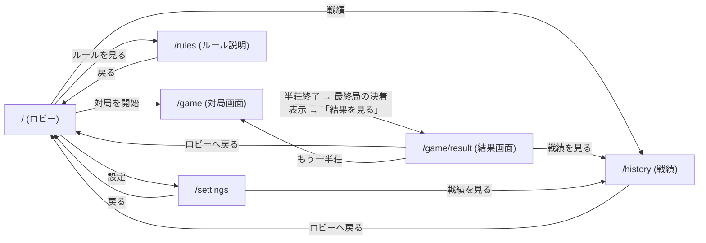

# スペック6: ゲーム画面UI設計とApp Routerルーティング設計

対象: [Issue #8](https://github.com/AutoDevJapan/FourBrosMahjong/issues/8) の受け入れ基準に対応する、対局UIの画面構成・ルーティング・コンポーネント分割の**設計**。
本スペックは **設計のみ** を範囲とし、実装(コード)は含まない。設計合意後、実装は別issue/PRで着手する(#9 がトップページ実装、#30 が対局画面ルートのE2Eを担当予定)。
ゲームドメインのロジック実装(牌山・配牌・和了判定など)は別レーンの責務であり、本スペックの対象外。
アクセシビリティ・レスポンシブ・ダークモードの横断方針は [`ui-accessibility-responsive-darkmode.md`](./ui-accessibility-responsive-darkmode.md)(スペック5)に従う。本スペックの各設計はスペック5の方針を前提とする。

## 6.1 背景

`src/app/` は現状 create-next-app のデフォルトのままで、ゲーム画面・ルーティングは未着手。
ゲームドメインは `documents/spec/setup-and-tiles.md`・`game-flow.md`・`scoring-and-settlement.md`・`domain-model.md`(スペック1〜4)で定義済みだが、**着席3人の席割り当て・抜け番の交代順序・場/親ローテーションの対応(`質問リスト.md` Q9〜Q11)は未確定**。本スペックはこれらの未確定事項を前提知識としたうえで、UIが「未確定のロジックを待たずに組める形」で画面・ルーティングを設計する(6.8節参照)。

## 6.2 画面一覧と責務

| 画面 | パス | 責務 | Server/Client |
|---|---|---|---|
| ロビー | `/` | エントリーポイント。対局開始・ルール説明・設定への導線を提供する(#9で実装) | Server |
| ルール説明 | `/rules` | `docs/四兄弟麻雀ルール.md` に基づくルール要約を表示する(閲覧専用) | Server |
| 対局画面 | `/game` | 四人回しサンマの対局本体。卓・各家の手牌/河/得点・ドラ・卓情報・操作パネルを表示する | Server shell + Client island |
| 結果画面 | `/game/result` | 半荘終了時の最終順位・ソシー内訳(素点+ウマ+祝儀)を表示する | Client |
| 戦績 | `/history` | `localStorage` に保存された半荘結果(最終順位・ソシー内訳・終了日時)を新しい順に一覧・閲覧し、全件削除できる(issue #293)。保存は半荘終了時に `GameProvider` が自動で行い、直近20件を上限に最古から破棄する。全件削除は失敗し得るため、成功したときだけ削除完了として通知する(issue #482 / 6.9) | Server shell + Client island |
| 設定 | `/settings` | ダークモード手動切替(スペック5 5.4.1)と対局者名の設定(6.2.1)、戦績ページへの導線 | Server shell + Client island |

### 6.2.1 対局者名の設定(issue #291)

四人回しの4人(index 0 = 自家、以降が他家3人)の表示名をユーザーが設定できる。

- **保存先**: `localStorage`(キー `four-bros-mahjong.playerNames.v1`)。同一ブラウザのみで、バックエンド/複数デバイス同期は行わない。
- **既定値**: engine の `DEFAULT_NAMES`(`あなた` / `一郎` / `二郎` / `三郎`)。未設定・破損・保存不可時はこれにフォールバックし、従来どおり動作する(後方互換)。
- **正規化**: 前後の空白を除去し連続空白を1つへ畳む。1人あたり最大12 **書記素クラスタ(grapheme cluster)**で切り詰め、絵文字・結合文字・ZWJ絵文字は見た目の1文字として数える。保存時とフォーム入力中は同じ分割関数を使い、UTF-16のサロゲートペアを分断しない。**ただし IME 変換中(未確定)は上限を適用しない** — ネイティブの `maxlength` は未確定文字列に適用されないのに対しフォームの `onChange` は未確定入力でも発火するため、ここで切り詰めると「日本語入力テスト」(確定後8書記素/読み13書記素)のように**読みだけが上限を超える**入力で変換が壊れる。上限は変換確定時と保存時に適用する。切り詰めの前に半端なサロゲート(lone surrogate)は U+FFFD へ置換するので、出力に lone surrogate は残らない。`Intl.Segmenter` 非対応環境では結合文字・variation selector・emoji modifier・ZWJ列・国旗ペアを保持する決定的fallbackを使う。空欄は既定名で埋める。
- **入力サイズの防御**: 書記素分割は入力長に比例したコストを払うため、分割へ渡す前に UTF-16 code unit の上限(12書記素がどんな構成でも収まる 12×32)で切る。数MBの貼り付けや改竄された保存値を、分割コストを払わずに拒否・切り詰めできる。戦績(6.9)側の防御上限も同じ考え方で持つ(後述)。
- **反映経路**: 保存値は半荘開始時(`/game` 初回描画・「もう一半荘」)に `createGame({ seed, names })` へ渡り、engine の `EnginePlayer.name` として保持される。盤面(`PlayerArea` / `BenchArea`)・結果画面(`RankingTable` / `SoshiiBreakdown`)・読み上げ(`LiveRegion`)へは既存の `selectView` 経由で自動的に反映される。
- **半荘中の変更**: 進行中の半荘の表示名は変わらない。名前は開始時に対局ジャーナル(`sessionStorage`、v2 で `names` を追加)へ固定され、リロード復元時もその名前で再生される。設定変更は**次に開始する半荘**から反映される。
- **ジャーナルの版移行**: v1(`names` 無し)の記録は既定名を補って v2 として受け入れる。`names` は表示名だけを決めるので、既定名を補っても Wall/RNG・操作列の再生結果は変わらない。これによりデプロイをまたいでタブを開いたままのユーザーが進行中の半荘を失わない。v2 で `names` が欠落・型不一致・空文字・12書記素クラスタ超のものは従来どおり拒否し、新規対局へフォールバックする。ただし **lone surrogate は拒否理由にしない** — 12書記素上限を code unit で適用していた頃(#484 以前)の記録は末尾が半端なサロゲートになり得るため、拒否せず読み込み時に U+FFFD へ正規化して受け入れる。表示名は再生結果に影響しないので、v1 の既定名補完と同じ「拒否より正規化」を採る。
- **実在人物名**: 既定値にもプレースホルダにも埋め込まない。本作は非公式ファンメイドであり、番組メンバー名を出荷物へ同梱してよいかは未確定(`質問リスト.md` Q28)。実名の入力はユーザーに委ねる。
- **名前の重複**: 4人に同じ名前を付けることを禁止しない(ユーザーの自由)。したがって戦績(6.9 / issue #293)の保存レコードも名前の一意性を前提にしてはならず、表示側の React key には名前ではなく順位を使う。
- **戦績側の名前検証**: 戦績(6.9)は**確定済みの表示スナップショット**なので、設定フォームの入力規則(12書記素)を再適用しない。改竄・破損に対する防御として UTF-16 code unit の上限のみを持ち、その値は 12書記素がどんな構成(ZWJ列・tag sequence 等、1書記素が十数 code unit になる場合を含む)でも収まる余裕を取る。設定側の上限を将来下げても保存済みの戦績が無効化されないよう、`MAX_PLAYER_NAME_LENGTH` へは結び付けない。

**受け入れ基準**

- Given 11書記素の名前の末尾へ絵文字を1つ入力 / When 保存して対局を開始し再読み込み / Then 12書記素目の絵文字を分断せず盤面へ同じ名前を表示する(#484)
- Given 絵文字または結合文字を含む名前 / When 12書記素クラスタを超えて入力 / Then 見た目の12文字までを保持し、出力にlone surrogateを含めない(#484)
- Given `Intl.Segmenter` 非対応環境 / When 結合文字・variation selector・emoji modifier・ZWJ列・国旗ペアを含む名前を制限 / Then fallbackが各列を途中で分断しない(#484)
- Given #484 修正前に保存された lone surrogate 入りの名前を含む対局ジャーナル / When リロードして復元する / Then ジャーナルを破棄せず、名前を U+FFFD へ正規化して進行中の半荘を再生する(#484)
- Given 日本語IMEで読みが12書記素を超える語(例: 「にほんごにゅうりょくてすと」→「日本語入力テスト」) / When 変換中に入力して確定する / Then 未確定文字列を切り詰めず変換を壊さない。確定後の文字列にのみ上限を適用する(#484)
- Given 1書記素が複数 code unit になる名前(家族絵文字・国旗・tag sequence)で12書記素 / When 半荘を終えて戦績へ保存する / Then 保存に失敗せず戦績へ残り、`/history` から読み戻せる(#484)

## 6.3 画面遷移



- **半荘終了時の遷移はユーザー操作(ボタン)で行い、自動遷移しない**(#277)。半荘を終える局(トビ / 南4完了 / 親トップやめ)は engine が `roundEnd` を経由せず `gameEnd` へ直行する(スペック2 2.8)ため、`/game` は `gameEnd` でも最終局の決着(和了内訳 `WinDetails`・流局サマリ・各家の点数増減)を表示し、主要ボタン「結果を見る」(push)で `/game/result` へ進む。`/game` は `gameEnd` で自動リダイレクトしないため、結果画面から「戻る」→ `/game`(最終局の決着表示)→「戻る」→ ロビーと履歴トラップなく脱出できる。終局済み journal のリロード復元・ブラウザバックでも同じ決着表示に合流する。**流局で半荘が終わり供託が残存**した場合は、engine が残存供託を最終局デルタへ畳み込み(スペック3 3.4 / #282)、hint・読み上げに「残存供託N本(N,000点)は◯◯が取得。」を併記して持ち点・点数増減・供託カウント0の三者を検算可能に保つ。

## 6.4 対局画面(`/game`)の表示要素とレイアウト設計

### 6.4.1 卓レイアウト(4スロット + 抜け番)

四人回しは「4人が順に3人打ちする」運用であり、UI上は**標準的な4人麻雀の卓と同じ4方向スロット(自家/上家/対面/下家)を維持し、そのうち1スロットが常に「抜け番」状態を表示する**設計とする。

- 理由: issueのスコープ記載は「各家の手牌(自家/上家/対面/下家)」と「抜け番表示」を別項目として挙げているが、四人回しでは常に4人中3人が着席するため、両者は同一の卓レイアウト上で表現するのが自然かつ`Round.seated`/`Round.benchWarmer`(スペック4 ドメインモデル)の形にも対応しやすい。
- 各スロットは `PlayerSlot` として抽象化し、その局の `seated` / `benchWarmer` の割り当て結果に応じて `PlayerArea`(着席時)または `BenchArea`(抜け番時)のどちらを描画するかを切り替える。
- どのスロット(自家/上家/対面/下家)にどの実プレイヤーが座るか、および誰が抜け番になるかの**決定ロジックは確定済み**(北家抜けの回転モデル、`質問リスト.md` Q9・Q10 / `game-flow.md` 2.5 / `domain-model.md` 4.5、6.8節)であり、ドメイン層が担う。UI側は「スロット→表示内容」のマッピングを受け取って描画するだけの構造にする。

### 6.4.2 表示要素の割り当て

| 表示要素 | 担当コンポーネント | 備考 |
|---|---|---|
| 卓(中央) | `Table` | 卓情報・ドラ表示を内包するコンテナ |
| 各家の手牌(自家/上家/対面/下家) | `PlayerArea` (4スロットぶん) | 自家のみ牌面を表向き表示、他家は伏せ牌(枚数のみ)。スート名+数字を`aria-label`に含める(スペック5 5.2.1) |
| 河(捨て牌) | `Discards`(`PlayerArea` の子) | 着席3人分。抜け番スロットには表示しない |
| ドラ表示 | `DoraIndicator` | 表ドラ表示牌(1〜3枚)と裏ドラ表示牌を「表」「裏」の別グループ(各 `aria-label` 付き `<ul>`+可視ラベル・仕切り)で描き、並び順に依存せず判別できる(スペック5 5.2.1 / #261)。裏ドラは対局中は枚数ぶん伏せ、リーチ和了の結果確定時のみ開示 |
| 点数表示 / ソシー(点棒)表示 | `ScoreDisplay`(`PlayerArea` の子) | 対局中は持ち点(素点)を表示。ソシー(素点+ウマ+祝儀)換算は `/game/result` の `SoshiiBreakdown` で表示 |
| 抜け番(休みプレイヤー)表示 | `BenchArea` | 名前・固定された持ち点・「抜け番」アイコン+テキストラベル(色のみに依存しない、スペック5 5.2.1)。半荘終了(`gameEnd`)時の残存供託の帰属(Q15/Q20)は抜け番にも及び得るため、点差(`pointsDelta`)は着席者と同様に表示する(#282) |
| 場風 / 局 / 本場 / 供託 | `TableInfo`(`Table` の子) | 卓中央に集約表示(場風・局数・本場・供託棒本数) |
| 和了内訳(局終了時) | `WinDetails` | 和了で局が終わると(**半荘を終える局 = `gameEnd` 直行時も含む** / #277)、和了者名+席(例: 一郎(南家))・親/子・ツモ/ロン・点数区分・成立役・翻内訳・支払いに加え、**和了形(和了確定時に固定した門前手牌+和了牌)を表向きで開示**する(#259)。和了牌は色に依存せず間隔+「和了」バッジ+`aria-label`「(和了牌)」で区別(スペック5 5.2.1)。副露・ガリは卓上の既存表示が公開情報として担うため重複表示しない。流局時は内訳非表示(テンパイ手公開はスコープ外) |

### 6.4.3 レスポンシブ方針との対応

スペック5 5.3.2 の狭幅時方針(`clamp()`によるスケーリング → 卓描画幅360px未満で「自分手番フォーカス表示」に切替)を `/game` にそのまま適用する。

- `md`以上: 4スロットのクロス/ロータリー型レイアウト(自家=下段, 上家=左, 対面=上, 下家=右)。
- ベース(`< 640px`)でスケーリングが視認性を損なう場合: 自家の手牌+操作パネルをフルサイズ表示、他3スロット(着席2人+抜け番)は直近の河数枚+得点+状態アイコンのみのコンパクト帯に縮小。全体盤面は折りたたみ/モーダルでいつでも確認可能にする。
- 横スクロールでのレイアウト成立は採用しない(スペック5に同じ)。

## 6.5 App Router ルート構成

```
src/app/
├── layout.tsx                  # ルートレイアウト (Server) — <html lang="ja">(#9), フォント, メタデータ
├── page.tsx                    # `/`        ロビー (Server)                      … #9で実装
├── globals.css
├── rules/
│   └── page.tsx                 # `/rules`   ルール説明 (Server)
├── settings/
│   └── page.tsx                 # `/settings` 設定 (Client)
├── history/
│   └── page.tsx                 # `/history`  戦績 (Server shell + Client island) … issue #293
└── game/
    ├── layout.tsx                # `/game` 配下の共有レイアウト (Client: GameProvider)
    ├── page.tsx                  # `/game`         対局画面
    └── result/
        └── page.tsx               # `/game/result`  結果画面
```

- `/game/layout.tsx` に対局状態(手牌・河・得点・進行フェーズ等)を保持する `GameProvider`(Client Component)を置き、`/game` と `/game/result` の間で同一の状態を共有する。バックエンド/永続化層は未設計のため、現時点では**単一デバイス上のブラウザメモリ内状態**を前提とする(6.8節の前提条件を参照)。
- `/game/result` を独立ルートにするのは、ブラウザの戻る/共有URLとして結果画面に直接アクセス可能にするため。ネストされたレイアウト(`game/layout.tsx`)配下に置くことで、ページ遷移時も `GameProvider` のインスタンスは再生成されず状態が保持される。

## 6.6 Server/Client Component 境界方針

原則: **ページ全体を `"use client"` にしない。** 静的な殻(レイアウト・見出し・ナビゲーション・メタデータ)は Server Component のまま維持し、ブラウザAPI・ローカル状態・イベントハンドラが必要な最小単位(葉コンポーネント)にのみ `"use client"` を付与する。

| 対象 | 境界 | 理由 |
|---|---|---|
| ルートレイアウト `src/app/layout.tsx` | Server | メタデータ・フォント読み込みのみ、状態を持たない |
| `/`(ロビー) `page.tsx` | Server | 静的なナビゲーションのみ |
| `/rules` `page.tsx` | Server | 静的コンテンツ表示、対話要素なし(折りたたみは `<details>`/`<summary>` 等HTML標準機能で対応しJS不要) |
| `/settings` `page.tsx` | Client | テーマ切替が `localStorage` / `matchMedia` というブラウザAPIを操作するため |
| `/game/layout.tsx`(`GameProvider`) | Client | 対局状態をメモリ上に保持し `/game` ⇄ `/game/result` 間で共有するため |
| `/game/page.tsx` | Server shell + Client island | ページ自体は Server とし、卓の操作領域を `<GameBoard>` として切り出し、その内部のみ `"use client"` |
| `<GameBoard>` 配下(`PlayerArea`・`ActionPanel`・`LiveRegion` 等) | Client | 打牌選択・鳴き・リーチ宣言等のキーボード/ポインタ操作、`aria-live` によるライブ更新(スペック5 5.2.2, 5.2.3)にローカル状態が必要 |
| `<Tile>`・`<ScoreDisplay>`・`<TableInfo>` 等の純表示コンポーネント(`<DoraIndicator>` は開示注記の `aria-describedby` 関連付けに `useId` を用いるため Client ツリー前提 / #261) | 値渡しのみなら Server Component として実装可能。ただし Client なコンポーネント(`GameBoard`等)の子として使われる場合、実質的にクライアントバンドルに含まれる点に留意 | props 経由で値を受け取り描画するだけの責務に留めることで、将来的な配置転換を容易にする |
| `/game/result/page.tsx` | Client | `GameProvider` の状態(確定したソシー内訳)を `useContext` 等で読み取るため |
| `/history/page.tsx` | Server shell + Client island | ページ自体は Server(metadata・見出し・戻る導線)とし、`localStorage` の戦績を読み書きする一覧・削除部分のみ `MatchHistoryList` として `"use client"` に分離する(issue #293) |

## 6.7 コンポーネント分割方針(`src/components/` 初期ディレクトリ構成案)

```
src/components/
├── layout/
│   ├── Header.tsx            # サイト共通ヘッダー・ナビゲーション (Server)
│   └── ThemeToggle.tsx        # ダークモード手動切替 ("use client"、スペック5 5.4.1。実装は本issueスコープ外)
├── game/
│   ├── GameBoard.tsx           # `/game` の対局本体を統括するクライアント境界 ("use client")
│   ├── Table.tsx                 # 卓(中央)コンテナ
│   ├── TableInfo.tsx              # 場風・局・本場・供託
│   ├── DoraIndicator.tsx          # ドラ表示
│   ├── PlayerSlot.tsx             # 4スロットの1つ。seated/benchで出し分け
│   ├── PlayerArea.tsx             # 着席プレイヤー(手牌・河・得点をまとめる)
│   ├── Hand.tsx                    # 自家手牌(キーボード操作対応、ロービングタブインデックス)
│   ├── OpponentHand.tsx            # 他家の伏せ手牌(枚数のみ)
│   ├── Discards.tsx                # 河
│   ├── ScoreDisplay.tsx            # 点数表示
│   ├── BenchArea.tsx              # 抜け番表示
│   ├── ActionPanel.tsx            # 打牌/鳴き/リーチ操作パネル ("use client")
│   └── LiveRegion.tsx             # aria-live 通知領域 ("use client")
├── result/
│   ├── RankingTable.tsx        # 最終順位表
│   └── SoshiiBreakdown.tsx      # 素点+ウマ+祝儀の内訳
└── common/
    ├── Tile.tsx                # 牌1枚の表示(スート名+数字+赤ドラをaria-labelに含む)
    ├── Button.tsx
    └── Modal.tsx                # フォーカストラップ対応(スペック5 5.2.2)
```

- ディレクトリは画面/ドメイン単位(`layout` / `game` / `result` / `common`)で分割し、`game/` 配下がもっとも大きくなる想定。
- `Tile` はスペック5 5.2.1 の要件(牌面印字+色は補助情報、赤ドラは形状差+`aria-label`付記)を満たす唯一の牌表示コンポーネントとし、`Hand`・`OpponentHand`・`Discards`・`DoraIndicator` すべてがこれを再利用する。
- **カタログ外牌の表示フォールバック(issue #146)**: 牌面 SVG は同梱素材(`public/tiles/` = 萬子1・9/筒索1〜9/赤5筒索/字牌7種)を網羅した集合に対してのみ写像する(`tileImage.ts` の `resolveTileFace`)。この集合に写像されない入力(サンマ非同梱の Man2〜8・赤5萬・字牌 rank 0/8 等)に対しては、`background-image`(読み込み失敗時に `onError` 不能)を発行せず、牌名テキストの**可視プレースホルダ**を前景に描く。これにより 404・空白牌・裏面(`Back`)誤描画を出さず、表向き牌に裏面を描かないことで視覚と `aria-label` を一致させる。赤扱い(色付き素材・赤枠・「赤」バッジ・`(赤ドラ)`)はドメイン層の単一判定 `isRedDora` を得点集計と共有し、赤素材が実在する 5筒・5索のみに発火させる。`isRed` がそれ以外に付いても牌面・バッジ・ラベル・赤ドラ翻の整合を保つ。

## 6.8 ドメインロジック確定事項(Q9〜Q13)との関係

Q9〜Q13 は**すべて解決済み**(`質問リスト.md`)。UI は引き続き「値を受け取って表示する」構造に徹し、下記ロジックはドメイン層(スペック1〜4)が担う。

- `PlayerSlot` → 実プレイヤーの割り当て(誰がどの局で自家/上家/対面/下家/抜け番になるか)の決定ロジックは、**北家抜けの回転モデル**として確定(Q9・Q10、`game-flow.md` 2.5・`domain-model.md` 4.5)。本スペックはスロット構造(4枠+出し分け)のみを定義し、割り当てアルゴリズムはドメイン層が持つ。
- `TableInfo` の「場」表示(東場/南場)・オーラス判定は**確定**(Q11: 各場4局・オーラス=南4、`game-flow.md` 2.6)。UI上は `roundWind` / `handNumber` / `honba` を props として受け取る箱に留める。
- `ScoreDisplay` のツモ和了時の増減表示は Q12(**ツモ損なし・北家折半方式**、`scoring-and-settlement.md` 3.1)で確定。UI側は「差分の数値」を受け取って表示するだけ。
- `SoshiiBreakdown`(結果画面)のウマ内訳表示は Q13(**4兄弟全員の最終順位に +10/+5/-5/-10**、`scoring-and-settlement.md` 3.3)で確定。UI側は `rawScore` / `uma` / `bonus` の3項目を表示する構造を持つ。
- いずれも **UIは「値を受け取って表示する」構造にとどめ、値の計算(ドメインロジック)は含めない**方針は変わらない(UI実装 #9 等は先行着手可能)。

## 6.9 対局中の状態管理に関する前提

- 半荘終了時の確定結果(最終順位・ソシー内訳・終了日時)は、`GameProvider` が `localStorage`(キー `four-bros-mahjong.history.v1`)へ**戦績**として追記保存し、`/history` で閲覧・全件削除できる(issue #293)。保存件数は直近20件を上限とし、超過時は最古から破棄する。進行中の半荘のジャーナル(`sessionStorage`)と同様に読み込み時の厳密検証と容量上限で防御する。複数タブの追記と全件削除は同じ Web Lock で直列化し、削除前の履歴を古い読み取り結果から復活させない(issue #482)。ロック取得またはストレージ操作に失敗した場合、全件削除は成功として案内しない。**ロック取得には追記・削除で共通の上限時間(3,000ms / `HISTORY_LOCK_TIMEOUT_MS`)を設ける**(issue #488) — `navigator.locks.request` は待ち時間の上限を持たないため、別タブがフリーズ・bfcache 等でロックを保持し続けると追記も削除も完了しない。上限を超えた場合は `AbortSignal` で待機を打ち切り、追記は保存失敗、削除は削除失敗として扱う(保存内容は変更しない)。中断は待機中にのみ効き、取得後のロックは中断されないため、排他区間の途中で打ち切られた中途半端な書き込みは残らない。保存はこの端末のブラウザ内で完結し、以下のバックエンド不在の前提を変えない。
- 現時点でバックエンド/永続化層・認証・複数デバイス間同期の設計は存在しない。本スペックは、四兄弟麻雀の実演形式(1台のデバイス/画面を囲んで進行する想定)に合わせ、**単一デバイス上のクライアントサイド状態(`GameProvider` の React state)** で対局を進行させることを前提とする。
- この前提はドメイン層(スペック4)の設計とは独立しており、将来的にサーバー同期やマルチデバイス対応が必要になった場合は改めて設計を見直す(本スペックの対象外)。
- **オフライン動作(PWA / issue #292)**: 対局がクライアント内で完結する上記前提を活かし、service worker(`/sw.js`、`src/app/sw.js/route.ts` がビルド毎バージョン付きで生成)が App シェル 5 ルート(`/`・`/rules`・`/settings`・`/game`・`/game/result`)と静的アセット(牌 SVG・アイコン・manifest)をキャッシュする。ナビゲーションは network-first(オンライン時は常に最新シェル、オフライン時のみキャッシュ応答)、ハッシュ付き `/_next/static/` と牌素材は cache-first。デプロイでバージョンが変わると activate 時に旧 `fbm-*` キャッシュを全破棄する。登録は production のみ(dev / E2E の dev サーバーではキャッシュ汚染防止のため無効)。オフライン時も `sessionStorage` ジャーナルによる対局復元(#190)とそのまま両立する。

## 6.10 完了基準(issue #8 受け入れ基準との対応)

- [x] 画面一覧とその責務が文書化されている(どの画面に何を表示するか) → 6.2節
- [x] 表示要素(卓・各家の手牌・河・ドラ・点数/ソシー・抜け番・場風/局/本場/供託)すべてが、いずれかの画面/コンポーネントに割り当てられている → 6.4.2節
- [x] 四人回しの抜け番表示の扱いが設計に含まれている → 6.4.1節・6.4.2節
- [x] App Router のルート構成(パスと対応ページ)が定義されている → 6.5節
- [x] Server/Client Component の境界方針が明記されている → 6.6節
- [x] コンポーネント分割の初期ディレクトリ構成案が示されている → 6.7節
- [x] 設計成果物が `documents/spec/`(本ファイル)としてレビュー可能な形で残っている

## 6.11 スコープ外(本スペックでは扱わない)

- 実装(コード)そのもの — 設計合意後、別issue/PRで着手する(#9: トップページ実装、#30: 対局画面ルートのE2E)
- ゲームドメインロジック(牌山生成・配牌・和了判定・点数計算等) — スペック1〜4の責務
- 抜け番順序・席割り当て・場/親ローテーション・ツモ配分・ウマ割当の具体的決定ロジック — `質問リスト.md` Q9〜Q13 で確定済み。実装はドメイン層(スペック1〜4)の責務であり、本 UI スペックの対象外
- ダークモード手動トグルの実装そのもの — スペック5 5.4.1で「別issueのスコープ」と明記済み
- ルール説明ページ(`/rules`)の本文コンテンツの確定(要約文言の作成) — 別途コンテンツ整備issueで対応
