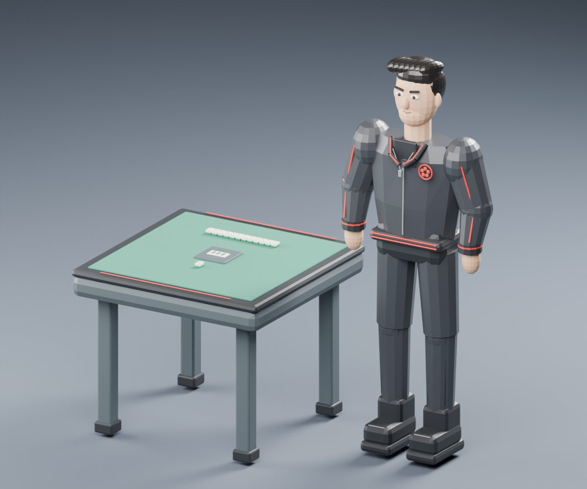
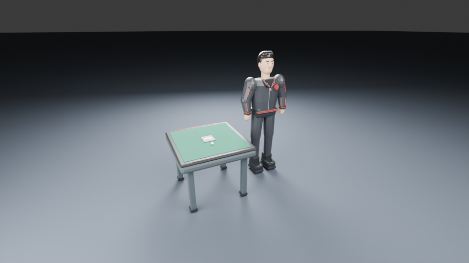
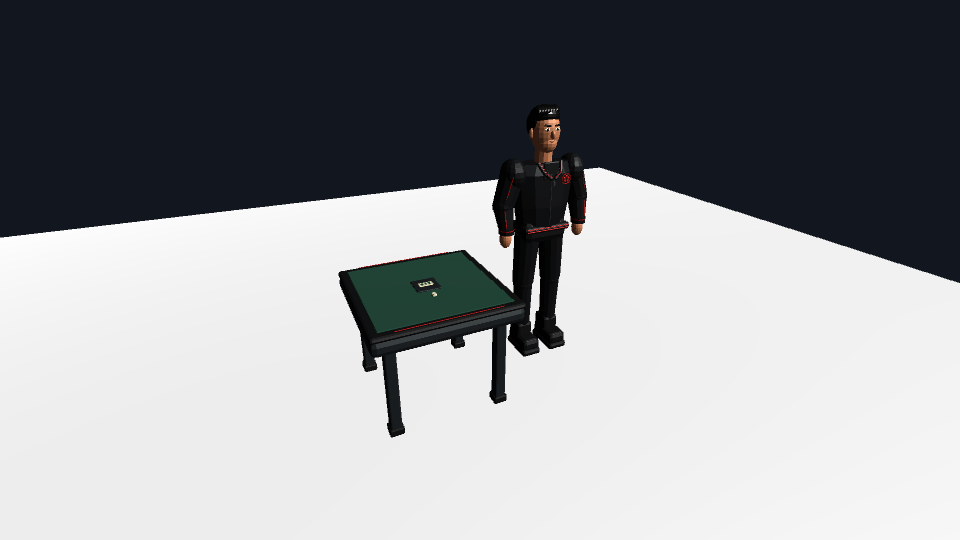
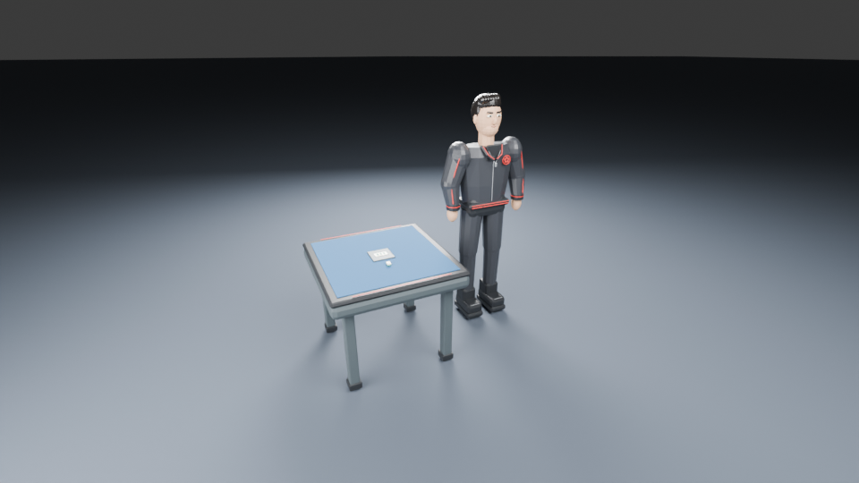
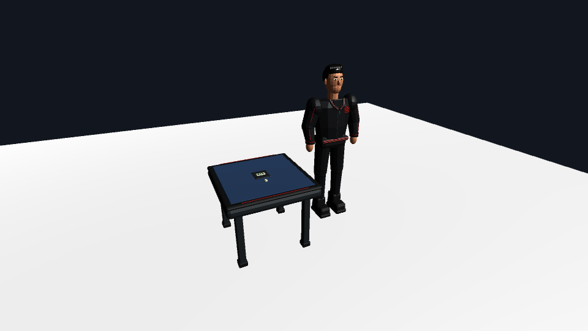

# Blender → Unity 3Dアセット試作（#1165）

Blender 5.2.0 LTSで制作した卓／五筒／粗悪品の簡略静止モデル。2026-09-08にUnity 2022.3.62f2／Apple M2／Metalで、FBX取り込み・再取り込み・GPU描画・カメラと牌移動の共通処理を実行した。#818の表示試作とは独立したアセット供給側の検証。物理マウス／キーボード入力とPlayerのFPSは未検証。

2026-09-08に、全スクリプトを別実行で再走させた追試記録を「[第三者による追試記録](#第三者による追試記録2026-09-08)」に追加した。



Unityプレビューカメラと同一の視点・画角で撮ったBlender側のレンダー。Unity側の`4 Capture Unity parity screenshot`が同じ枠で撮るため、2枚を並べて比較できる。



## 成果物

| ファイル | 内容 |
|---|---|
| `generated/fourbros-study.blend` | 編集可能なBlenderシーン。名前付きメッシュ・UV・材質・照明・カメラを含む |
| `generated/MahjongTable.fbx` | 幅94cm、天板高さ約78cmの卓 |
| `generated/TilePin5.fbx` | 幅26mm、長さ36mm、厚さ約18.5mmの五筒。牌面はメッシュ形状 |
| `generated/SoakuhinStudy.fbx` | 高さ約180cm、黒髪・黒い上着・赤いラインの人物試作 |
| `generated/manifest.json` | バージョン、寸法、ポリゴン数、材質パレット、出典ハッシュ、生成時間 |
| `generated/revision/` | 保存済み`.blend`を開き、フェルトだけ緑→青に変更した再書き出し版 |
| `generated/fbx-validation.json` | 基準版＋改訂版の計6FBXをBlenderへ実際に再読み込みした検証結果 |
| `generated/tile-detail.png` | 五筒の牌面の実レンダー |
| `generated/unity-camera-parity.png` | Unityプレビューカメラと同一の視点・画角・解像度でのBlenderレンダー（960×540） |
| `generated/unity-camera-parity.json` | 上のレンダーのカメラ諸元・除外オブジェクト・一致範囲 |
| `generated/revision/unity-camera-parity.png` | 同一視点での青フェルト改訂版レンダー |
| `generated/reproduction-2026-09-08.json` | 2026-09-08の追試記録（環境・実行時間・再現性の測定結果） |
| `generated/unity-validation-2026-09-08/` | 実際のUnity GPU描画4枚と、6FBX・GUID・配置・材質・幾何・操作共通処理・負荷の実測JSON |
| `../unity-display/Assets/FourBrosBlenderStudy/` | Unity用取り込み・材質再適用・シーン作成・カメラ／牌移動・パリティキャプチャ・batch検証スクリプト |

## 再生成

リポジトリルートから実行する。既存の出力や手動編集を上書きしないよう、生成先は**空のディレクトリ**を指定する。既存成果物は読み込みだけで確認でき、再生成は不要。

```sh
# macOSの例。別環境ではBlenderの実行ファイルパスを変更する。
/Applications/Blender.app/Contents/MacOS/Blender \
  --background --factory-startup --python-exit-code 1 \
  --python prototypes/blender/build_assets.py -- \
  --output prototypes/blender/validation-local/baseline --render

# 保存した実ファイルを開き、フェルトを変更して再保存・FBX再書き出し
/Applications/Blender.app/Contents/MacOS/Blender \
  --background --factory-startup --python-exit-code 1 \
  --python prototypes/blender/revise_assets.py -- \
  --baseline prototypes/blender/validation-local/baseline \
  --output prototypes/blender/validation-local/revision

/Applications/Blender.app/Contents/MacOS/Blender \
  --background --factory-startup --python-exit-code 1 \
  --python prototypes/blender/verify_fbx.py -- \
  --baseline prototypes/blender/validation-local/baseline \
  --revision prototypes/blender/validation-local/revision \
  --report prototypes/blender/validation-local/fbx-validation.json
```

コミット済み成果物だけを再検証する場合、最後のコマンドのbaseline/revisionを`prototypes/blender/generated`とその`revision`へ変更し、reportだけ`validation-local/`へ出す。成功条件は終了コード0と`PASS: 3 assets`。失敗時は`--python-exit-code 1`で非ゼロ終了する。

再生成した成果物がコミット済み成果物と一致するかは`compare_builds.py`で確認する。FBXはバイト一致しない（後述）ため、両方をBlenderへ読み込んで幾何・材質を比較する。

比較は空の資産集合と、左右で資産名が増減している場合も拒否する。Blender不要の回帰検証は`python3 -m unittest discover -s prototypes/blender -p 'test_*.py'`で実行でき、資産の増減・空集合・面順序・巻き方向・面の重複を確認する。

```sh
/Applications/Blender.app/Contents/MacOS/Blender \
  --background --factory-startup --python-exit-code 1 \
  --python prototypes/blender/compare_builds.py -- \
  --left prototypes/blender/generated \
  --right prototypes/blender/validation-local/baseline \
  --report prototypes/blender/validation-local/reproduction-baseline.json
```

成功条件は終了コード0と`PASS: 3 assets geometrically identical across builds`。`revision`同士も同じ手順で比較する。

`generated/`配下のJSONはBiomeの整形対象（`pnpm check`がCIゲート）なので、スクリプトの出力を`generated/`へコミットし直す場合は`pnpm format`を通してから確認する。短い配列が1行にまとめられるだけで、値は変わらない。

Unityプレビューカメラと同じ視点のBlenderレンダーは`render_unity_parity.py`で作る。出力先が既存の場合は上書きせず失敗する。

```sh
/Applications/Blender.app/Contents/MacOS/Blender \
  --background --factory-startup --python-exit-code 1 \
  --python prototypes/blender/render_unity_parity.py -- \
  --blend prototypes/blender/generated/fourbros-study.blend \
  --output prototypes/blender/validation-local/unity-camera-parity.png \
  --report prototypes/blender/validation-local/unity-camera-parity.json
```

## 第三者による追試記録（2026-09-08、Unity検証前の履歴）

コミット済み成果物とスクリプトを、生成時とは別の実行で追試した。証跡は`generated/reproduction-2026-09-08.json`。

| 項目 | 値 |
|---|---|
| OS | macOS 26.2（build 25C56）、arm64 |
| Blender | 5.2.0 LTS（hash `fbe6228777e7`、built 2026-07-14 01:31:22）、`/Applications/Blender.app/Contents/MacOS/Blender` |
| Unity Editor／Hub | 未導入（`ls /Applications \| grep -i unity` が無一致） |

| 実行 | 結果 | 実時間 |
|---|---|---:|
| `build_assets.py --render`（空ディレクトリへ再生成） | 終了コード0、FBX3本＋`.blend`＋レンダー | 20.6秒（スクリプト内計測16.5秒） |
| `revise_assets.py`（保存済み`.blend`を開いてフェルト変更・再書き出し） | 終了コード0 | 15.1秒（同13.7秒） |
| `verify_fbx.py`（再生成したbaseline＋revision） | `PASS: 3 assets` | 1.0秒 |
| `verify_fbx.py`（コミット済み`generated/`＋`generated/revision/`） | `PASS: 3 assets`、出力JSONは`generated/fbx-validation.json`と完全一致 | 1.0秒 |
| `compare_builds.py`（コミット済み vs 再生成、baseline／revisionとも） | `PASS: 3 assets geometrically identical across builds` | 各約4秒 |
| `render_unity_parity.py`（baseline／revision） | 960×540 PNGを各1枚 | 各約20〜29秒 |

### 再現性の測定結果

- **頂点は完全再現する。** 6本すべてのFBXで、ワールド座標の頂点値と頂点の並び順が一致した（許容誤差10µm）。
- **面の格納順は再現しない。** `TilePin5/PipDot_*`と`SoakuhinStudy`の一部メッシュで、同一の面集合が異なる順序で返る。`compare_builds.py`は各面を最小インデックス始まりに正規化した多重集合で比較するため、巻き方向の反転や面集合の変化は検出しつつ格納順の差は許容する。
- **FBXはバイト再現しない。** 書き出し時刻とソースの絶対パスがヘッダーに埋まるため、同一入力でもsha256とファイルサイズが変わる（例: `TilePin5.fbx` 85,884 → 85,900 bytes、`SoakuhinStudy.fbx` 470,924 → 470,860 bytes）。したがって`manifest.json`のsha256は「manifestと隣のFBXが対応していること」の検証には使えるが、**再現性の判定には使えない**。再現性は`compare_builds.py`で判定する。
- **否定検証。** `compare_builds.py`は資産ごとに5種の変異（バウンディングボックス移動、内部頂点変形、材質色変更、面の巻き方向反転、面集合の差し替え）を必ず拒否することを実行時に確認する。加えて実ファイルでの対照として、`generated/`と`generated/revision/`を`variant`だけ揃えて比較させると`Base colour differs: MahjongTable/Felt`で失敗することを確認した（青フェルトの差を実際に検出できる）。

### CIでの固定

Blender/Unityを持たないCIでも壊れを検出できるよう、`src/test/blender-asset-study.test.ts`で以下を固定した。

- コミット済み6本のFBXのsha256とバイト数が各`manifest.json`と一致すること。
- 改訂版がフェルト色だけの変更で、メッシュ数・三角形数・材質名が基準版と同一であること。
- 全メッシュにUVがあり、画像テクスチャ0バイトであること。単位・軸の記録が`metres`/`Z`/`Y`であること。
- `fbx-validation.json`が`manifest.json`と整合し、否定検証が記録されていること。
- 過去の4つの成果物の`unityValidation: not-run-editor-unavailable`を履歴として保持すること。今回の実測は別の`unity-validation-2026-09-08/`へ保存する。
- READMEの実測表の三角形数・FBX容量がmanifestの数値と一致すること。
- Blender側パリティレンダーのカメラ定数（yaw/pitch/distance/垂直画角/解像度）が、Unity側の`BlenderStudyCamera.cs`・`BlenderAssetStudy.cs`の定数と一致すること。

## Unity実測（2026-09-08）

`generated/unity-validation-2026-09-08/unity-validation.json`と4枚のPNGは、Unity EditorのC#を実際に実行して生成した。6FBXのSHA-256が元のmanifestと一致し、Unity側の116メッシュ／14,940三角形、UV・法線、m単位の寸法を確認した。再取り込み前後でFBXのGUID・Prefab参照・3インスタンスのTransform・幾何／UV／法線ハッシュ・材質参照を維持し、Feltの色だけ緑→青に変わった。鼻と左右非対称の胸章の座標も確認した。

| Blender（既存の同一視点） | Unity（今回のGPU描画） |
|---|---|
|  |  |
|  |  |

輪郭・正面・胸章・配置は一致する。UnityはStandard材質・平行光源＋Flat環境光で、BlenderのCycles studio rigとは照明・色管理が異なり、服と肌が暗く、床は白い。照明・陰影・色の一致は今回の合格条件にしていない。

Fキーで牌を注視点にし、距離0.6m・pitch 65°・1920×1080で[牌面を描画](generated/unity-validation-2026-09-08/unity-tile-detail.png)すると、中央の赤1点と周囲4点を識別できた。[移動後の描画](generated/unity-validation-2026-09-08/unity-tile-moved.png)も保存した。共通コントローラーを呼び、周回・ズーム・100msで8cm／200msで16cm移動・元位置復帰を数値で検証した。これらは`Update`が使うメソッドの実行であり、物理入力やPlayモードの入力配送を実行した証拠ではない。

| 実測対象 | 値・境界 |
|---|---|
| 環境 | macOS 26.2.0、Apple M2、Unity 2022.3.62f2、Metal、Built-in／Gamma |
| Camera.Render CPU所要時間 | 960×540、ウォームアップ5回後の30回、中央値0.31625ms／p95 0.354ms |
| Editor全体の割当メモリ | 94,910,004 bytes（`Profiler.GetTotalAllocatedMemoryLong`、このモデルだけの増分ではない） |
| 未測定 | GPU完了・画面present・Player FPS・入力遅延・ビルド容量・#818シーンと合算した負荷 |

CPU計測は同期GPU完了を待たない`Camera.Render`の所要時間で、これをFPSに換算していない。初回シェーダーコンパイルも除外している。Unityのモデル頂点数はUV／法線境界で分割されるためBlenderの頂点数と異なる。manifestの寸法は各メッシュの変換済み包囲箱の和集合で、回転した曲面の実頂点より広い。JSONは比較用の`conservativeMeshBoundsSize`と実頂点の`boundsSize`を両方記録する。

実描画で見つけた修正は、FBXの変換後に人物が後ろ向きだったためY軸180°を加えたこと、環境光の`Flat`指定、空の未保存起動シーンでのシーン生成例外、牌フォーカス操作の追加。既存FBXと`.blend`のバイトは変更していない。元の追試JSONにあるUnity未導入の記録も書き換えていない。

追試コマンド（出力先は空のディレクトリ。GPU描画が必要なので`-nographics`は付けない）：

```sh
/Applications/Unity/Hub/Editor/2022.3.62f2/Unity.app/Contents/MacOS/Unity \
  -batchmode -quit -projectPath "$PWD/prototypes/unity-display" \
  -executeMethod FourBros.BlenderStudy.BlenderStudyChecks.Run \
  -blenderStudyReportDir "$PWD/prototypes/blender/validation-local/unity-check" \
  -logFile "$PWD/prototypes/blender/validation-local/unity-check.log"
```

終了コード0、`PASS: Blender study Unity validation`、JSONと4PNGを確認する。メニュー`5 Validate imports and capture evidence`でも実行できる。検証は取り込んだ材質とFBXを基準版に戻し、保存済みシーンを復元するため、既存シーンを保存してから実行する。

## Unity側の対話操作手順（物理入力は未検証）

手順8のキャプチャはPlayモードを終了してから実行する（Play中は拒否する）。これにより牌の移動を戻し、カメラのyaw／pitch／distanceも既定値へ明示的にリセットして基準画像と比較する。C#コンパイル・GPUキャプチャ・メモリAPIは前節で実測済み。物理入力とProfilerの対話操作は残る。

対象候補はmacOS Editor、Built-in Render Pipeline、Unity 2022.3.62f2（#818と共通）。実行後にEditorの正確な版を記録する。URP/HDRPのシェーダー変換は対象外。FBXはUnityが主にサポートするモデル形式のため採用した（[Unity公式](https://docs.unity3d.com/2022.3/Documentation/Manual/ImportingModelFiles.html)）。

1. Unity Editorのインストールとライセンス認証を済ませる。#818と#1165の両変更を含むcheckoutで`prototypes/unity-display`を開く（Unityプロジェクト設定は#818側で追加）。
2. `Assets/FourBrosBlenderStudy/`のスクリプトがコンパイルされ、`FourBros > Blender Study`メニューが現れることを確認する。#1165単独の場合は空の3D Built-inプロジェクトへこのAssetsサブフォルダーをコピーしてもよい。
3. `Edit > Project Settings > Player > Active Input Handling`を`Input Manager (Old)`または`Both`にする。
4. `FourBros > Blender Study > 1 Import baseline`を実行する。リポジトリ配下のUnityプロジェクトなら`prototypes/blender/generated`を自動検出する。外部プロジェクトならフォルダーを選ぶ。
5. `2 Build asset preview scene`を実行する。保存済みシーンは保持し、追加シーンを固有名で保存する。空の起動シーンは置き換え、未保存オブジェクトがあれば保存を求めるエラーにする。プレビューシーンだけを開いてPlayし、右ドラッグで周回、ホイールでズーム、Spaceで牌を200msで移動、Fで牌へフォーカス、Homeで初期視点へ戻す。
6. 人物の正面・卓の上面・五筒の牌面が正しく向いているか、1 Unity unit＝1mの寸法かを確認する。材質はmanifestのパレットからStandard材質へ明示的に割り当てる。BlenderとUnityの照明・色管理による差も確認する。
7. Playを終了し、各モデルのTransformとFBXのGUIDを記録する。`3 Reimport blue felt revision`を実行し、フェルトだけ青に変わり、モデル参照・配置が保持されるか確認する。スクリプトは`.meta`を残し、既存GUIDの不一致をエラーにする。
8. Playモードを終了してから`4 Capture Unity parity screenshot`を実行する。プレビューカメラを初期視点へ戻し、垂直画角60°・960×540でRenderTextureへ描画して`Assets/FourBrosBlenderStudy/Captures/unity-camera-parity.png`を書き出す（Captures/はgitignore）。これは`generated/unity-camera-parity.png`と同じカメラ位置・注視点・画角・アスペクトで撮られるため、形状・寸法・配置を比較できる。照明と色管理は一致させていない。今回のbatch検証でも同じCamera.Render経路の画像を取得した。
9. 牌面の可読性は初期視点では判定しない。カメラ→牌の距離2.854 m・垂直画角60°では、五筒の牌面は960×540で高さ約5.9 px、1920×1080でも約11.8 px、点の直径は1 px未満になる。Fで牌へフォーカスし、1920×1080以上で判定する。Fは注視点も牌へ移すため、卓中心へのズームと異なり実距離0.6 mになる。
10. Unityのスクリーンショット／短い録画、Consoleエラー、Profilerのフレーム時間・メモリ、実機／画面解像度を記録する。Blenderの証跡をUnityの証跡として扱わない。

`.blend`にある人物・卓の横並び配置は撮影用。FBXはアセットごとに原点へ戻して書き出す。BlenderはZ-up、FBXはY-up／forward -Z、単位はm。Unityの取り込みが作るX軸回転を保持したままY軸180°を加えると、Blender (x,y,z) がUnity (x,z,y) に一致することを鼻と胸章の座標で実測した。

## 実測と品質判断

| アセット | メッシュ数 | 三角形数 | FBX容量 | UV付きメッシュ |
|---|---:|---:|---:|---:|
| 卓 | 18 | 1,656 | 90,572 bytes | 18 |
| 五筒 | 12 | 2,056 | 85,884 bytes | 12 |
| 人物 | 86 | 11,228 | 470,924 bytes | 86 |

全メッシュにUVを作成している。画像テクスチャは0 bytesで、単色材質とメッシュの牌面を使う。UVはパーツごとの自動展開で、全身を1枚のアトラスにまとめた状態ではない。元画像をテクスチャとして貼り付けていない。

Blenderで基準／改訂FBXを各3種読み込み、バウンディングボックス（許容誤差10µm）、三角形数、メッシュ数、UV、法線、材質名、改訂前後のオブジェクト名を確認した。改訂比較は各メッシュのワールド座標の全頂点と面の接続も比較する。基準／改訂ともFBXの色が対応manifestに一致し、改訂版ではFeltの色だけ変わり、他の色と形状は変わらないことを確認した。全体移動・内部頂点変形・manifestとの色不一致を検出する負の検証も各アセットで実行した。

`generated/unity-camera-parity.png`はUnityプレビューカメラと同じ視点で撮ったBlender側のレンダーで、Unity側の同名キャプチャと直接比較するための基準になる。この視点では卓と人物の輪郭・寸法関係は判別できるが、五筒の牌面は高さ約6 px（960×540）で読めない。牌面の可読性はズーム下限0.6 m・1920×1080で判定する必要がある。

人物の正面シルエット・黒髪・黒／赤の服装は確認できるが、元絵の顔つき・刺繍・布の質感の再現度は低く、本番キャラクター品質には達していない。リグ・ウェイト・待機動作は未実装。五筒はUnityの牌フォーカス画像で識別できたが、対局用カメラの可読性は別に評価する。116メッシュをそのまま使うため、材質統合・メッシュ統合・牌面アトラスによる軽量化を本番前に検討する。

基準版の制作＋CPUレンダーの1実行は約15秒（`manifest.json`）。これはスクリプト実行時間であり、設計・実装・レビューを含む制作総時間でもUnityのフレーム時間でもない。Astraの利用トークン／課金額はこの実行環境から取得できないため未計測。Unityの負荷は前掲の限定したCPU描画時間とEditor割当メモリのみ測定した。

## 制作コスト・既知の制約

| 項目 | 記録 |
|---|---|
| スクリプト実行時間 | 基準版の制作＋1200×1000ヒーローレンダーで実時間20.6秒、改訂版15.1秒、FBX再読み込み検証1.0秒、ビルド間比較 各約4秒、パリティレンダー 各約20〜29秒（macOS 26.2 arm64、Cycles CPU） |
| 制作総時間 | 上記はスクリプト実行時間のみ。設計・実装・レビュー・文書化を含む総時間は別で、この試作では計測していない |
| Astraの利用量・費用 | この実行環境から取得できず未計測 |
| 手動調整 | Blender GUIでの手作業はゼロ。すべてPythonスクリプト経由。ただし形状・比率・色は人が数値を書いて調整しており、参照画像からの自動生成ではない |
| 画像テクスチャ | 0バイト。単色材質とメッシュ形状の牌面のみ。UVはパーツ単位の自動展開で、アトラス化していない |
| リグ・アニメーション | **未実装**。ボーン・ウェイト・待機動作のいずれも作っていない。FBXは`bake_anim=False`で書き出しており、アニメーションの検証は行っていない（残課題） |
| キャラクター再現度 | 正面シルエット・黒髪・黒／赤の配色は確認できるが、顔つき・刺繍・布の質感は再現できていない。本番品質ではない |
| メッシュ数 | 3資産で116メッシュ。材質統合・メッシュ統合・牌面アトラスによる軽量化が本番前に必要 |
| 再現性 | 幾何・材質は再現するが、FBXのバイト・sha256と面の格納順は再現しない（前掲） |
| Unity側の負荷 | 前掲のCPU描画時間・Editor割当メモリを測定。Player FPS・GPU完了・入力遅延・ビルド容量は未測定 |

## 受け入れ条件の充足状況

| #1165の受け入れ条件 | 状態 | 根拠 |
|---|---|---|
| 利用環境・操作方法と第三者が追試できる手順 | 済 | 本README「再生成」「第三者による追試記録」、`generated/reproduction-2026-09-08.json` |
| 卓・代表牌・キャラクター1体の編集元とUnity用データの保存場所 | 済 | `generated/fourbros-study.blend`＋FBX3本、`generated/revision/` |
| Unity上での表示・カメラ操作・牌移動 | 部分達成 | GPU描画、Update共通処理による周回・ズーム・牌移動は実測。物理入力／Playモード入力配送は未検証 |
| Blenderでの変更→書き出し→Unity再取り込みを1回以上 | 済 | 既存改訂FBXをUnityへ再取り込み、GUID・配置・参照・材質・幾何を検証 |
| スクリーンショット／録画でBlenderとUnityの見た目比較 | 済 | 前掲のBlender／Unity基準版・改訂版、Unity牌面／移動画像 |
| 表示品質・負荷・手動調整・制作コスト・既知の制約の記録 | 済（測定範囲を限定） | 品質比較・CPU描画時間・Editorメモリ・未測定範囲を前掲。Player性能の合格を意味しない |
| アニメーションの結果または残課題 | 済 | 未実装であることと残課題を上表に明記 |
| Go／No-Goと後続Issue分割案、#818との接続点 | 済 | 次節 |

## 判定と残りの作業

**静止アセットのBlender制作→FBX→Unity取込・再取込フローはGo。本番採用はNo-Go。**

幾何と材質の受け渡し、再取り込み時の参照維持、Unity描画まで実証したため、少量の静止アセットで継続制作できる。物理入力確認は残り、キャラクター品質・全牌種・Player性能・権利確認・リギングは本番利用前の後続作業とする。

- [x] 卓・牌・キャラクター1体の編集元とFBXを保存した。
- [x] `.blend`を編集した改訂版を再書き出しし、Blender再読み込みで比較した。
- [x] レンダー・ハッシュ・寸法・三角形数・実行手順を保存した。
- [x] 別実行で全スクリプトを再走させ、幾何が再現すること／バイトと面順は再現しないことを測定した。
- [x] Unityプレビューカメラと同一視点のBlenderレンダーを用意し、Unity側に同じ画角で撮るメニューを追加した。
- [x] Blender成果物の整合性をBlender非依存のVitestで固定した。
- [x] Unityのコンパイル、取り込み、GPU描画、カメラと牌の共通処理を検証した。
- [x] Unityで再取り込み時の配置・参照・材質を検証した。
- [x] UnityパリティキャプチャとCPU描画／メモリ実測を保存した。
- [ ] Playモードの物理入力と、#818シーンを含むPlayer性能を確認する。
- [ ] リグと待機動作を検証する。

### 後続Issueの分割案

| 分割案 | 内容 | 前提 |
|---|---|---|
| A. Unity実機検証 | Playモードの物理入力・PlayerのGPU／FPS・#818シーン合算負荷を記録する。取込・再取込・静止GPU描画は本Issueで実施済み | 実入力可能なEditor／対象Player環境 |
| B. 全牌種の牌面 | 34種＋赤5・北の牌面をメッシュまたはテクスチャアトラスで量産し、可読性をズーム下限0.6 m・1080pで判定する | A（可読性の実測基準がAで確定する） |
| C. 軽量化 | 116メッシュの統合、材質統合、牌面アトラス、LOD検討 | A（負荷の実測値が必要） |
| D. 残り3キャラクター＋品質改善 | 顔・衣服・質感の作り込みと、参照素材の権利確認 | なし（Blender側で先行可能） |
| E. リギングと待機動作 | ボーン・ウェイト・待機モーションを作り、FBXの`bake_anim`を有効にしてUnityで再生確認する | A・D |

### #818との接続点

- 本Issueは**アセットの供給側**、#818は**表示・状態同期の契約側**。境界はFBXと`manifest.json`（単位m、Z-up→Y-up、原点は各アセット原点、材質はパレット名で参照）に置く。
- Unityプロジェクト設定（`prototypes/unity-display/ProjectSettings/`）は#818が持つ。本Issueが持つのは`Assets/FourBrosBlenderStudy/`の取り込み・シーン生成・カメラ／牌移動・パリティキャプチャのみで、#818の表示契約・fixtureには手を入れていない。
- AのPlayer検証は#818のシーンと同一checkoutで実施し、Profilerのフレーム時間は#818の表示シーンと合算で見る。今回のCPU計測値は独立したアセットプレビューのみ。
- ルール・点数・合法性はC#へ二重実装せず、既存のserver/domainに置く方針を維持する。

## 出典・制作記録

ユーザー指示: 「Astraを用いてBlenderとUnityを連携」「#818、#1165を開発」。本試作はその範囲でAstraがPythonとC#を作成し、Blender CLIを実行した。MCP接続は使っていない。手動のBlender GUI編集なし。AIによる画像生成サービスも使用していない。2026-09-08の追試（再生成・ビルド間比較・パリティレンダー・Vitest固定）も同じ方針で、Blender CLIとリポジトリ内スクリプトのみで実施した。

人物の参考: `documents/assets/characters/originals/p0-soakuhin-character-sheet.png`。画像を目視し、色・髪・服の特徴を簡略形状にした。胸の円形花模様は幾何形状の仮意匠で、元の刺繍の複製ではない。参照画像のSHA-256はmanifestに記録。利用根拠・未確認の権利情報は[既存CREDITS](../../documents/assets/characters/CREDITS.md)を継承し、この試作で新たな再配布ライセンスは付与しない。卓・牌の形状は今回のスクリプトで作成。OSS／Majsoul由来のモデル・画像・音声は取り込んでいない。

初回の`/godd-a/dev`は`GODD_LICENSE_KEY is required`で起動できなかった。今回の再接続は既存設定を使ったが`REGISTRY_ORIGIN_UNVERIFIED`で拒否されたため、GoDD自体の実行成功とはせず、計画→実装→検証→品質確認→文書化を手動で実施した。今回のUnity検証はEditor CLIとC#で行い、GUIのマウス／キー入力は行っていない。
